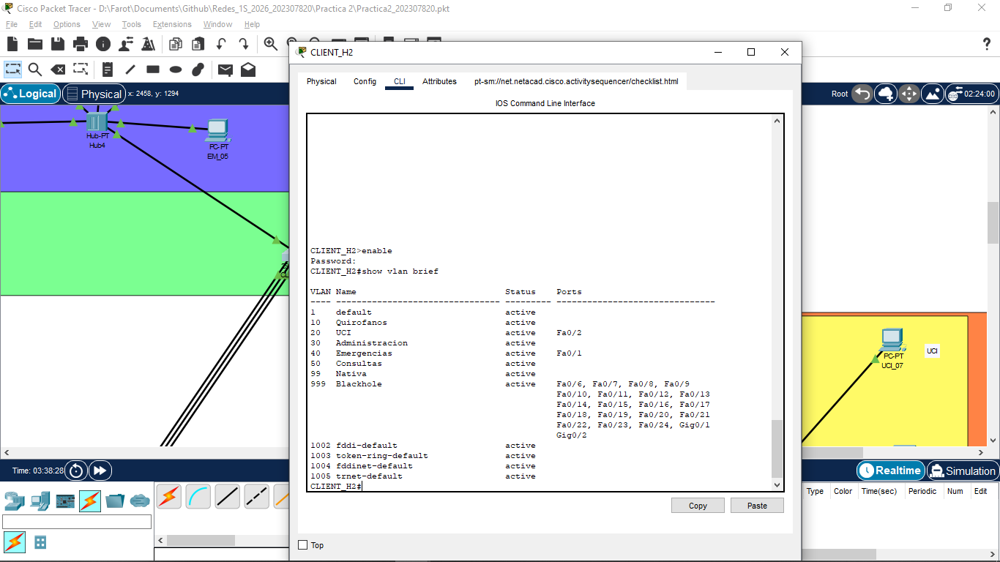
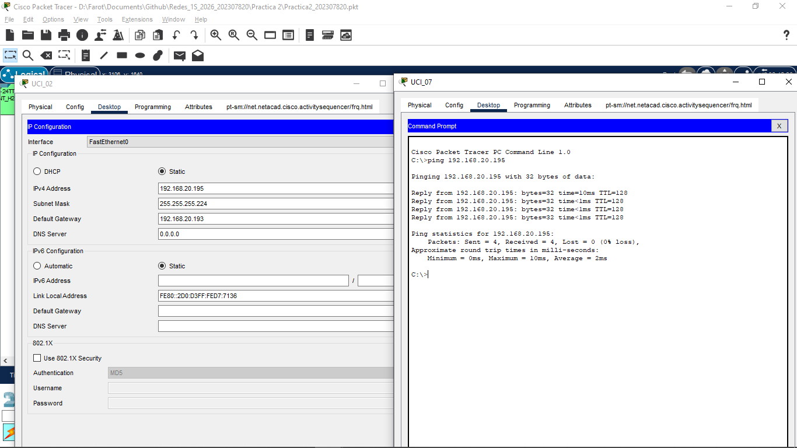

# Informe de Desarrollo: Implementación de Red Hospitalaria Nacional
**Estudiante:** Ottoniel FabricioVásquez Pineda | **Carnet:** 202307820

## 1. Introducción
La presente práctica consistió en el diseño e implementación de una topología en estrella que interconecta 6 hospitales regionales. Se aplicaron conceptos avanzados de Capa 2 y Capa 3 del modelo OSI para garantizar la redundancia, seguridad y segmentación del tráfico médico.

## 2. Implementación de la Práctica
La red se segmentó en 5 VLANs principales (Quirófanos, UCI, Administración, Emergencias y Consultas), además de una VLAN Nativa (99) y una VLAN de seguridad (999). 

### Hitos de Configuración:
* **EtherChannel (PAgP):** Se agruparon enlaces físicos para aumentar el ancho de banda entre el Core y los Hospitales.
* **VTP v2:** Se centralizó la creación de VLANs en el Switch Server.
* **Rapid PVST+:** Se optimizó la convergencia de la red, designando al Switch Central como Root Bridge.

## 3. Problemas Encontrados y Soluciones Adoptadas

| Problema | Causa | Solución |
| :--- | :--- | :--- |
| El VTP no sincronizaba las VLANs en los hospitales. | Discordancia en la contraseña del dominio. | Se estandarizó el password a `area10` en toda la topología. |
| Varios switches de diferentes edificioes se declaraba como Root Bridge. | Inconsistencia en la VLAN Nativa y prioridad por defecto. | Se forzó la prioridad a `4096` en el Core y se configuró `switchport mode trunk` estático otra vez a cada edificio. |
| Aviso de loop al conectar Hubs. | Spanning-tree Portfast detectando múltiples dispositivos. | Se mantuvo Portfast en accesos para velocidad, verificando que no existan bucles físicos. |

## 4. Pruebas de Funcionamiento

### 4.1. Verificación de VTP y VLANs

 

### 4.2. Verificación de Spanning Tree (STP)

 

 

### 4.3. Conectividad End-to-End

 

