UNIVERSIDAD DE SAN CARLOS DE GUATEMALA

FACULTAD DE INGENIERIA

REDES DE COMPUTADORAS

CATEDRÁTICO: ING. ESPINO

============================================================================================

  
  

    <h1 style="color: White; text-decoration: underline; text-decoration-color: black;" >MANUAL TÉCNICO Red de Hospitales Metropolitanoy</h1>
  

============================================================================================

OTTONIEL FABRICIO VÁSQUEZ PINEDA
 
CARNÉ: 202307820
 
SECCIÓN A

GUATEMALA 10 DE MARZO DEL 2026

## Topología Usada de Estrella

 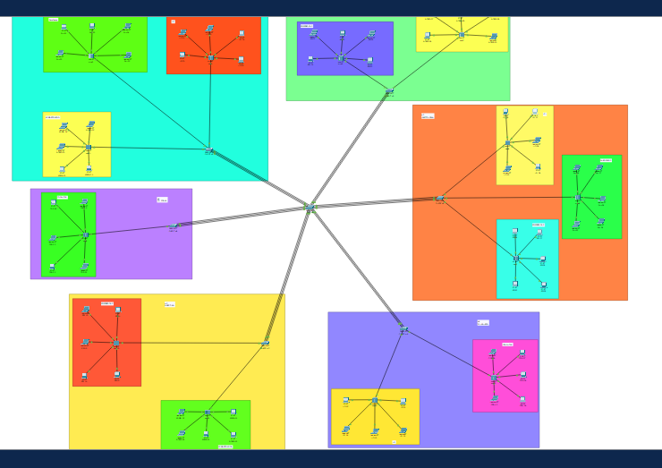

 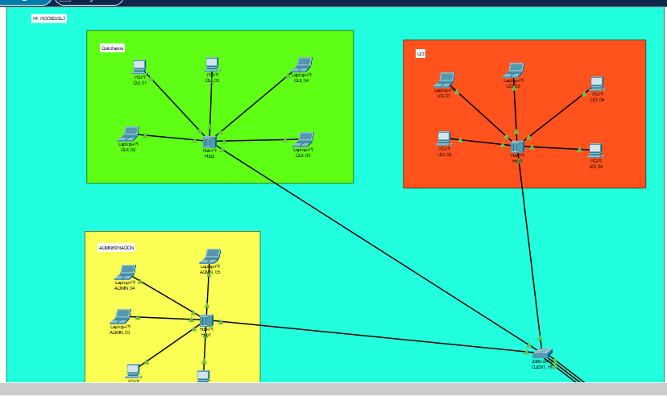

 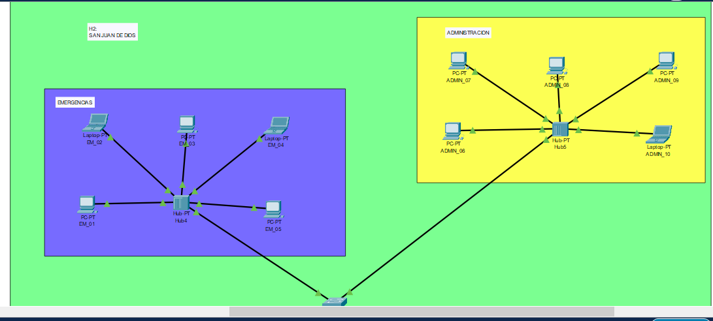

 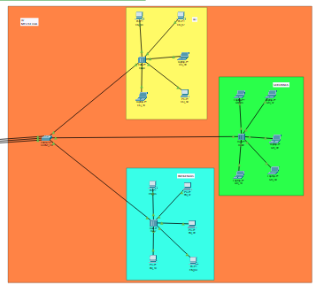

 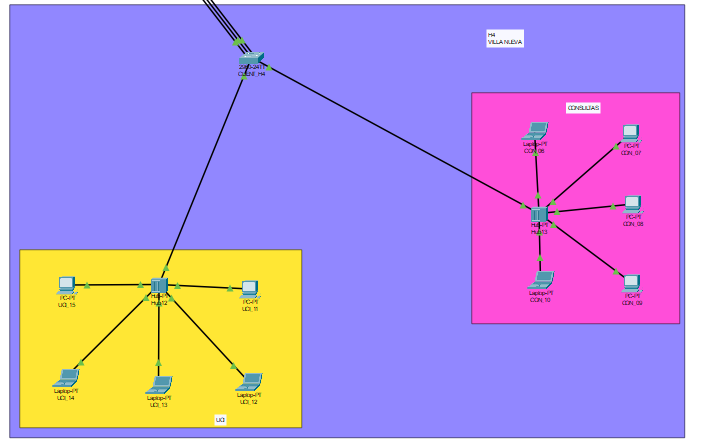

 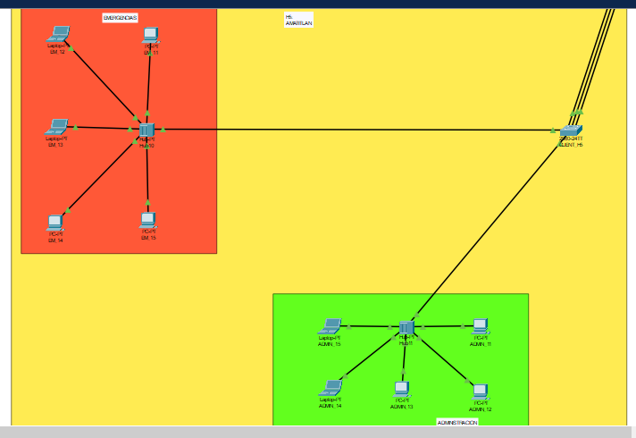

 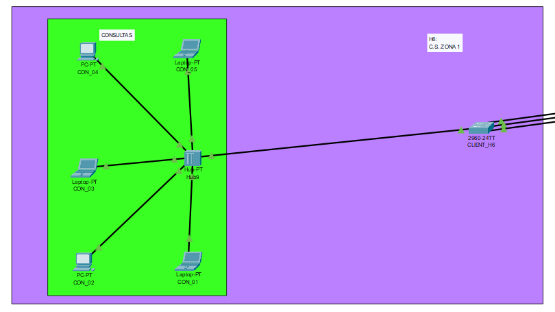

## Tabla de subnetting organizada por área.

| Area | VLAN | Hospitales que comparten | Máximo de Hots | Red | Máscara(Decimal) | CIDR | Gateway |
| -----|-------|-------------------------|---------------|-----|-------------------|----|----------|
| Quirófanos | 10 | H1, H3 | 63 | 192.168.20.0 | 255.255.255.128 | /25 | 192.168.20.1 |
| Admin. | 30 | H1, H2, H5 | 32 | 192.168.20.128 | 255.255.255.192 | /26 | 192.168.20.129 |
| UCI |  20 | H1, H3, H4 | 26 |  192.168.20.192 | 255.255.255.224 | /27 | 192.168.20.193 |
| Emergencias | 40 | H2, H3, H4 | 25 | 192.168.20.224 | 255.255.255.224 | /27 | 192.168.20.225 |
| Consultas | 50 | H4, H6 | 15 | 192.168.21.0 | 255.255.255.255.240 | /28 | 192.168.21.1 |

---
 
 
 

## Comandos utilizados

### Switch Server
* enable
* configure terminal

### 1. Configuración Básica
* hostname SERVER
* enable secret 202307820

### 2. Configuración VTP (Modo Server)
* vtp mode server
* vtp domain 202307820
* vtp password area10
* vtp version 2

### 3. Creación de VLANs (Capa 2)
* vlan 10
  * name Quirofanos
* vlan 20
  * name UCI
* vlan 30
  * name Administracion
* vlan 40
  * name Emergencias
* vlan 50
  * name Consultas
* vlan 99
  * name Nativa
* vlan 999
  * name Blackhole
* exit

### 4. Modo Spanning Tree (Rapid PVST+)
* spanning-tree mode rapid-pvst
* spanning-tree vlan 10,20,30,40,50,99 root primary

### 5. Configuración de EtherChannel (Hacia H1 como ejemplo)
### Se repite este bloque con los demás hospitales
* interface range fa0/1 - 3
  - switchport trunk native vlan 99
  - switchport mode trunk
  - channel-group 1 mode desirable  # PAgP
* exit

* interface port-channel 1
  * switchport trunk native vlan 99
  * switchport mode trunk
* exit

### 6. Seguridad: Puertos no usados a la Blackhole
* interface range fa0/19 - 24, gi0/1 - 2
  * switchport mode access
  * switchport access vlan 999
  * shutdown
* exit

 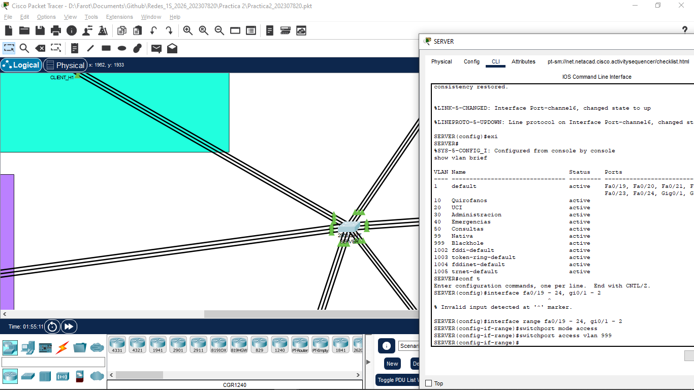

---

### Clientes

* enable
* configure terminal

### 1. Configuración Básica
* hostname CLIENT_H1  # Cambia según el hospital (H1, H2...)
* enable secret 202307820

### 2. Configuración VTP
* vtp mode client
* vtp domain 202307820
* vtp password area10
* vtp version 2

### 3. Modo Spanning Tree (Rapid PVST+)
* spanning-tree mode rapid-pvst

### 4. Configuración de EtherChannel (Hacia el SERVER)
* interface range fa0/1 - 3
  * switchport trunk native vlan 99
  * switchport mode trunk
  * channel-group 1 mode desirable
* exit

* interface port-channel 1
  * switchport trunk native vlan 99
  * switchport mode trunk
* exit

### 5. Asignación de Puertos de Acceso (Ejemplo con H1)

### Puerto para Quirófanos (VLAN 10)
* interface fa0/2
  * switchport mode access
  * switchport access vlan 10
  * spanning-tree portfast  # Optimiza la conexión de los Hubs

### Puerto para UCI (VLAN 20)
* interface fa0/3
  *  switchport mode access
  * switchport access vlan 20
  * spanning-tree portfast

### Puerto para Administración (VLAN 30)
* interface fa0/1
  * switchport mode access
  * switchport access vlan 30
  * spanning-tree portfast

### 6. Seguridad: Puertos no usados a la Blackhole
* interface range fa0/7 - 24, gi0/1 - 2
  *  switchport mode access
  * switchport access vlan 999
  * shutdown
* exit

## Capturas de configuraciones de cada hospital

 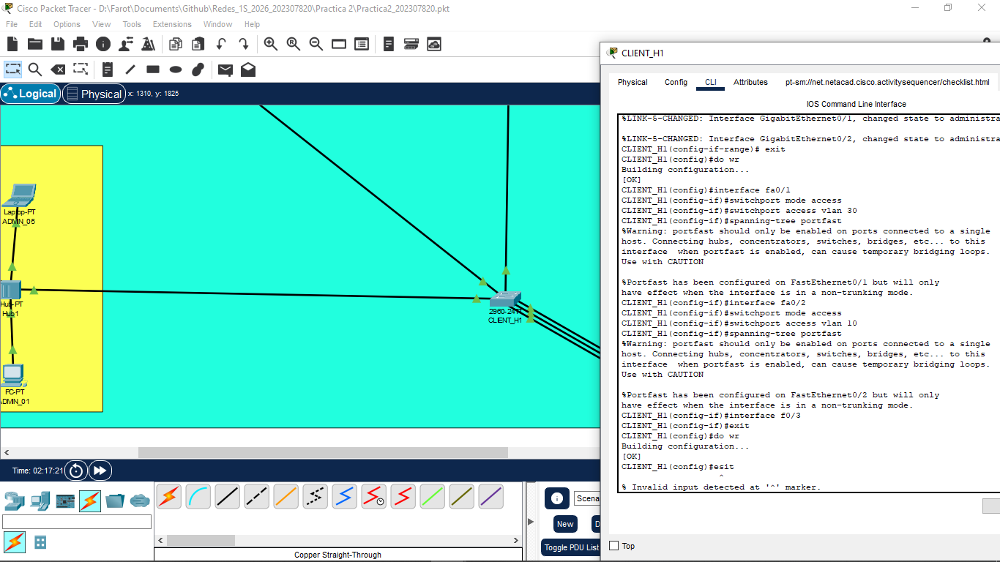

 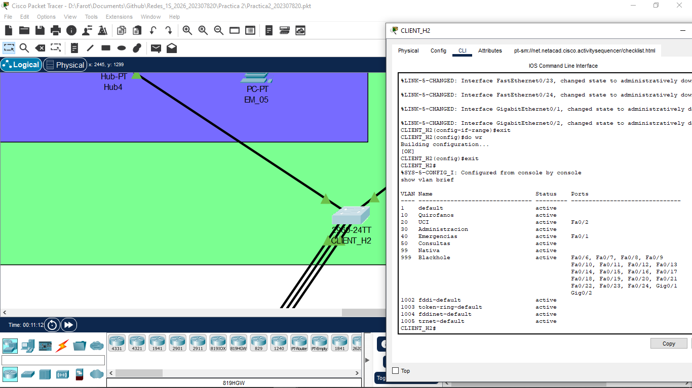

 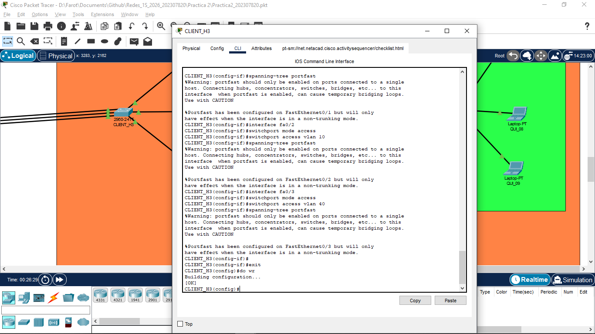

 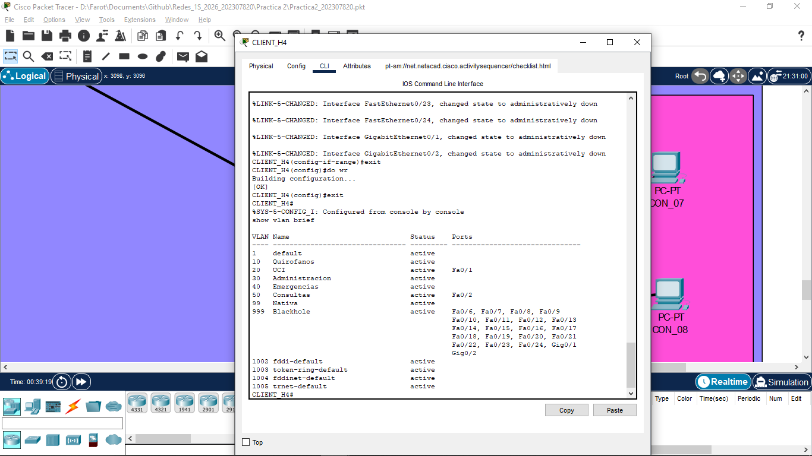

 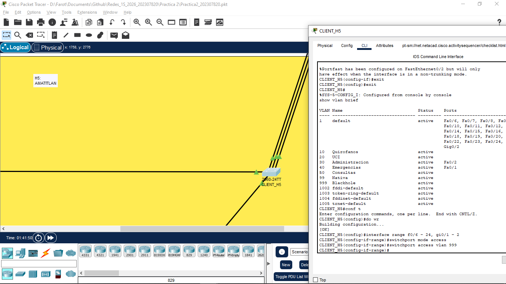

 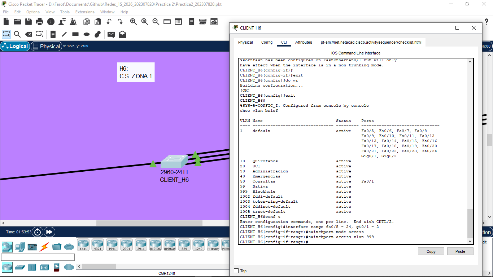

 
 
 

### Tabla de IPS

| Hospital | Nombre Area | Tipo de dispositivos | ips|
|----------|-------------|----------------------|----|
| H1 Roosevelt | QUI_01 | COMPUTADORA | 192.168.20.2 |
| H1 Roosevelt | QUI_02 | LAPTOP | 192.168.20.3 |
| H1 Roosevelt | QUI_03 | COMPUTADORA | 192.168.20.4 |
| H1 Roosevelt | QUI_04 | LAPTOP | 192.168.20.5 |
| H1 Roosevelt | QUI_05 | LAPTOP | 192.168.20.6 |
| H1 Roosevelt | ADMIN_01 | COMPUTADORA | 192.168.20.130 |
| H1 Roosevelt | ADMIN_02 | COMPUTADORA | 192.168.20.131 |

 
 

---

## Análisis de Paquetes y Conectividad

### Análisis de ICMP:

 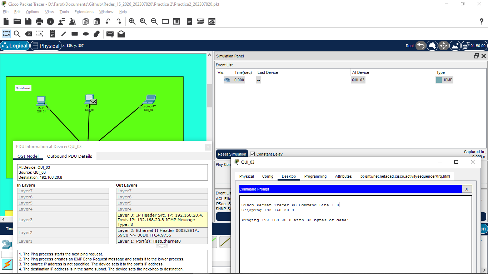

 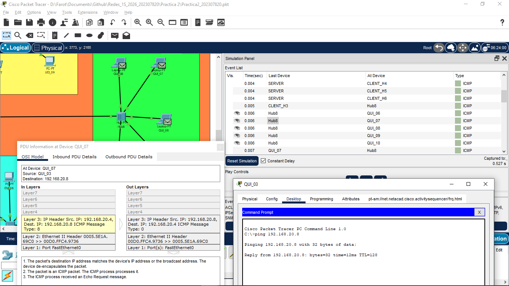

 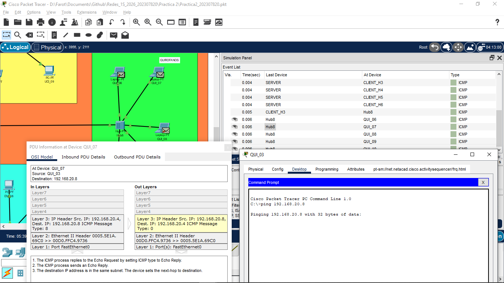

 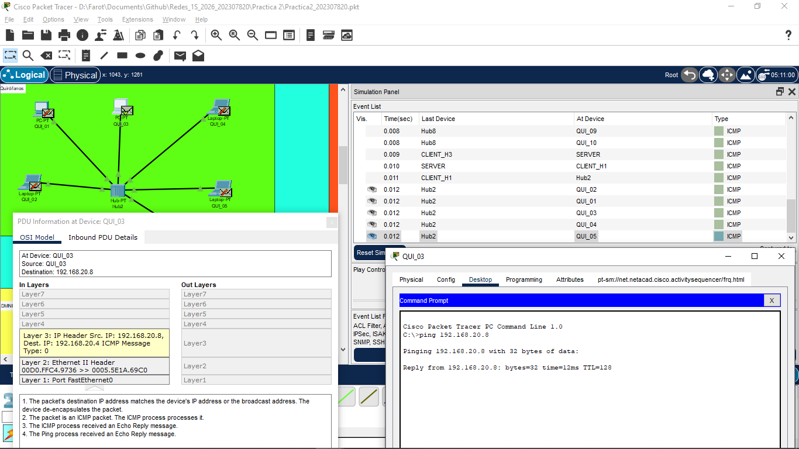

### Análisis de ARP

 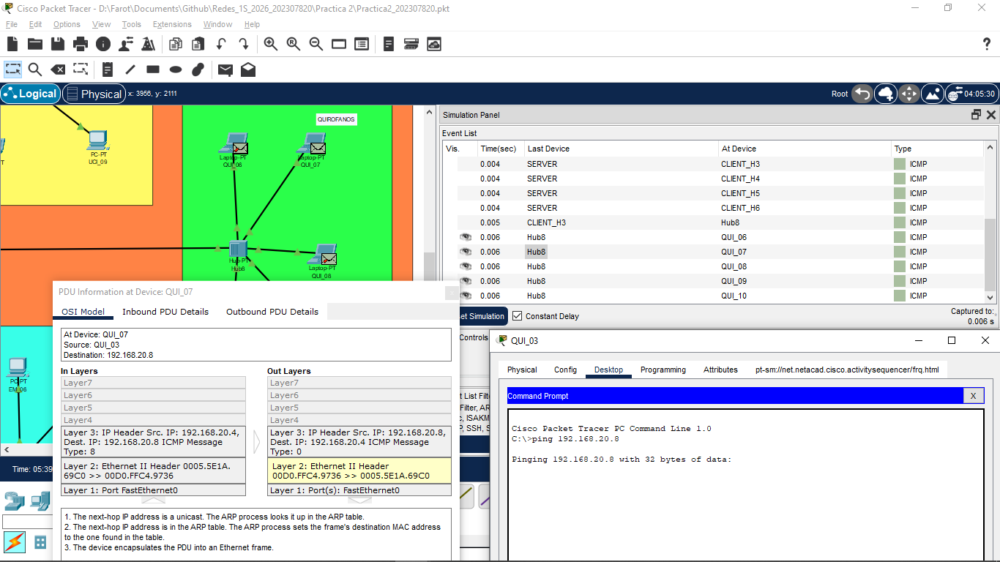

## Segurida de Puertos
Todos los puertos no utilizados fueron asignados a la VLAN 999 y apagados administrativamente mediante el comando shutdown.

 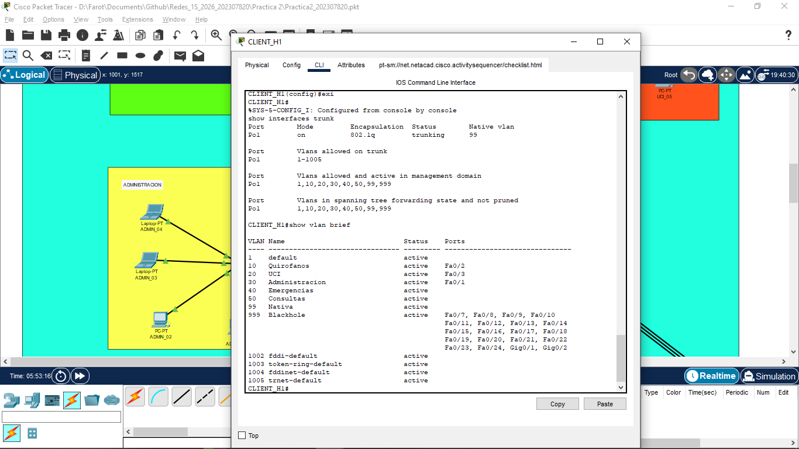

