UNIVERSIDAD DE SAN CARLOS DE GUATEMALA

FACULTAD DE INGENIERIA

REDES DE COMPUTADORAS

CATEDRÁTICO: ING. ESPINO

============================================================================================

  
  

    <h1 style="color: White; text-decoration: underline; text-decoration-color: black;" >MANUAL TÉCNICO DISEÑO E IMPLEMENTACIÓN DE RED LAN</h1>
  

============================================================================================

OTTONIEL FABRICIO VÁSQUEZ PINEDA
 
CARNÉ: 202307820
 
SECCIÓN A

GUATEMALA 19 DE Febrero DEL 2026

## Tabla de IpS

| Piso | Nombre area | Tipo de dispositivos | Rango ips|
|------|-------------|----------------------|----------|
| 1    | Departamento de recepción | Computadora | 1 - 11|
| 1    | Departamento de recepción | Servidor | 55 |
| 1    | Departamento de contabilidad | Computadora | 12 - 19 |
| 1    | Departamento Legal | Computadora y laptops | 20 - 24 |
| 1    | Sala de Reuniones | Computadora y laptops | 25 - 29 |
| 2    | Departamento de Arquitectura | Computadoras y laptops | 30 - 35 |
| 2    | Departamento de Urbanismo | Computadoras y laptops | 36 - 40 |
| 2    | Departamento de Urbanismo | Servidor | 56 |
| 2    | Sala de Reuniones de Planos | Computadora y Laptops | 41 - 45 |
| 3    | Departamento de Dirección General | Laptops | 46 - 49 |
| 3    | Departamento de Ingenieria Civil | Computadora y laptops | 50 - 54 |
| 3    | Departamento de Ingenieria Civil | Servidor | 60 |
| 3    | Departamento de Servidores Principales | Servidor | 57 - 59 |

## Configuración de switches

Switch> enable
Switch# config t
Switch(config)# hostname (nombre del switch)
nombre del switch(config)# enable password 202307820
nombre del switch(config)# do wr

## Capturas de las 10 Areas

 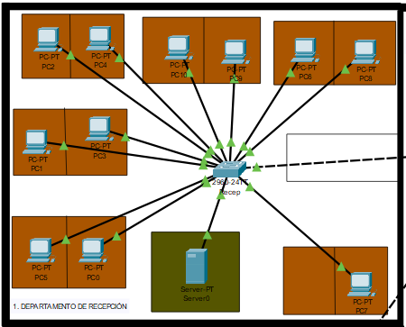

 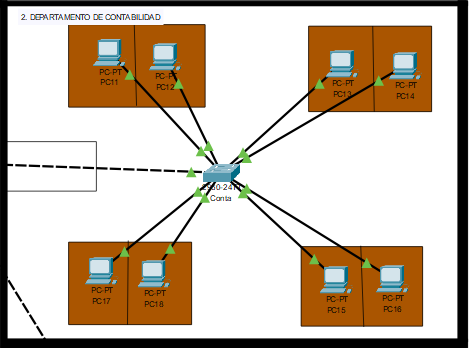

 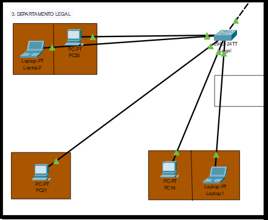

 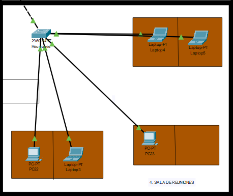

 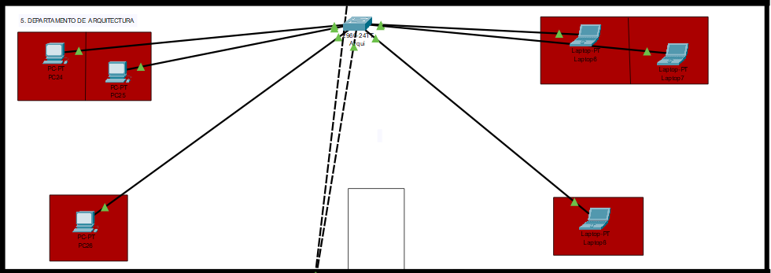

 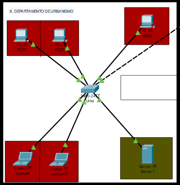

 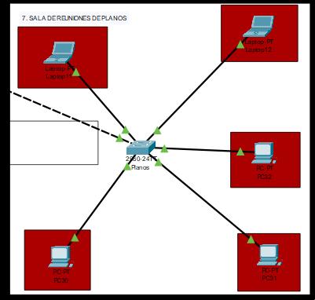

 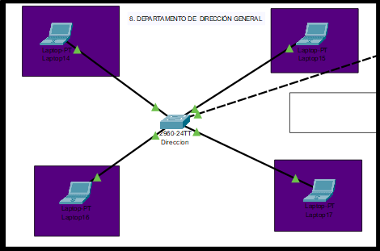

 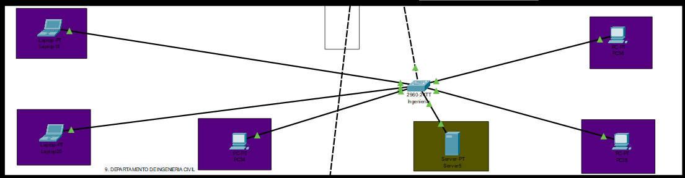

 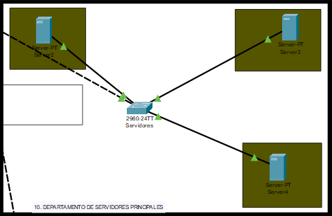

## Capturas de ping

 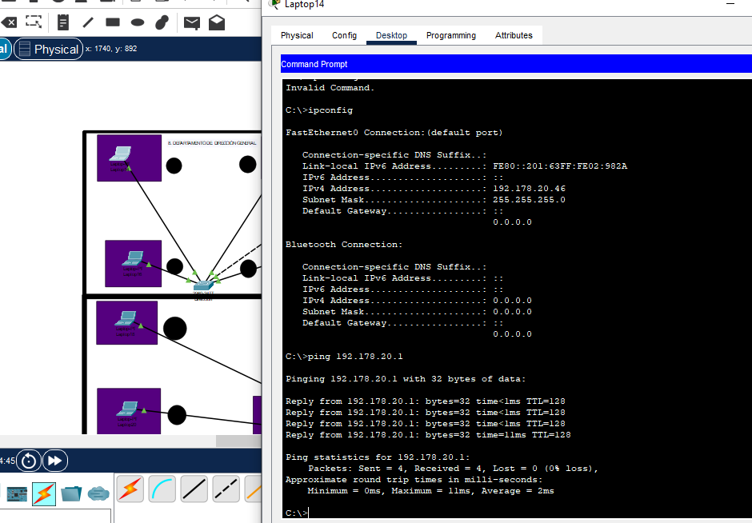

 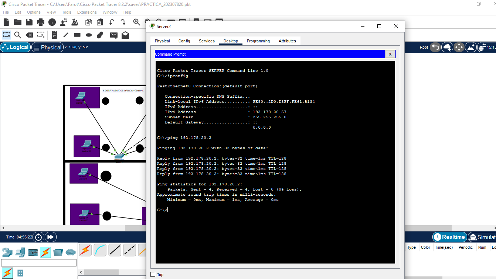

 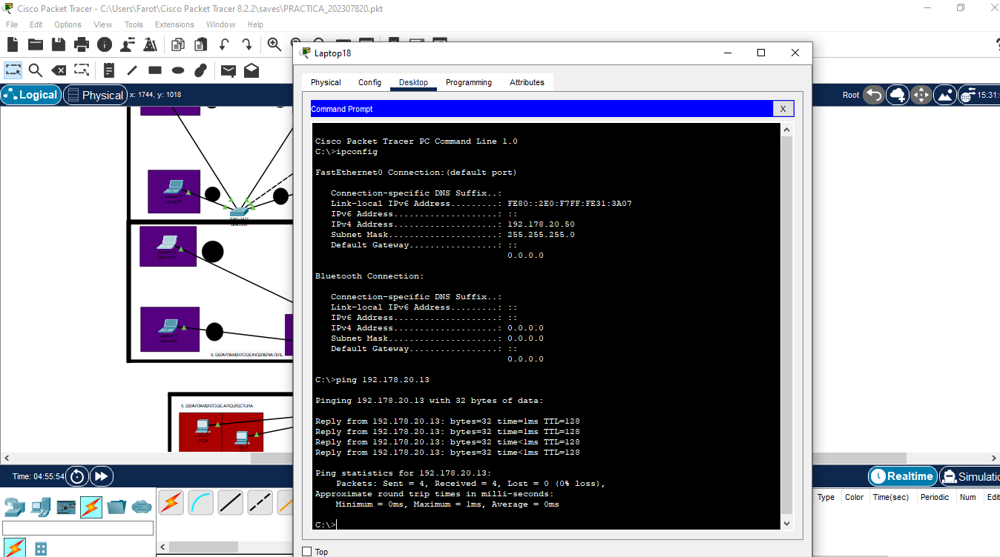

 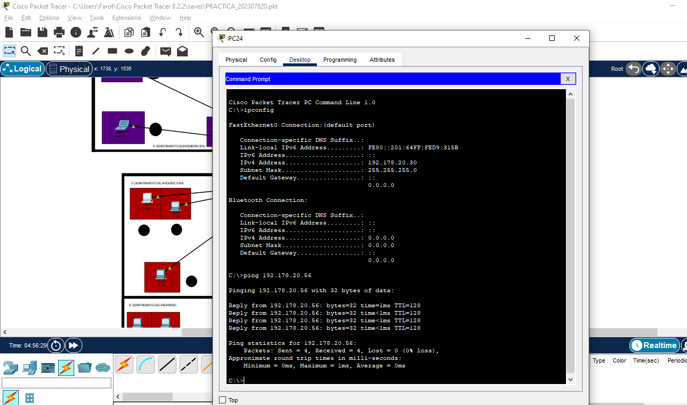

 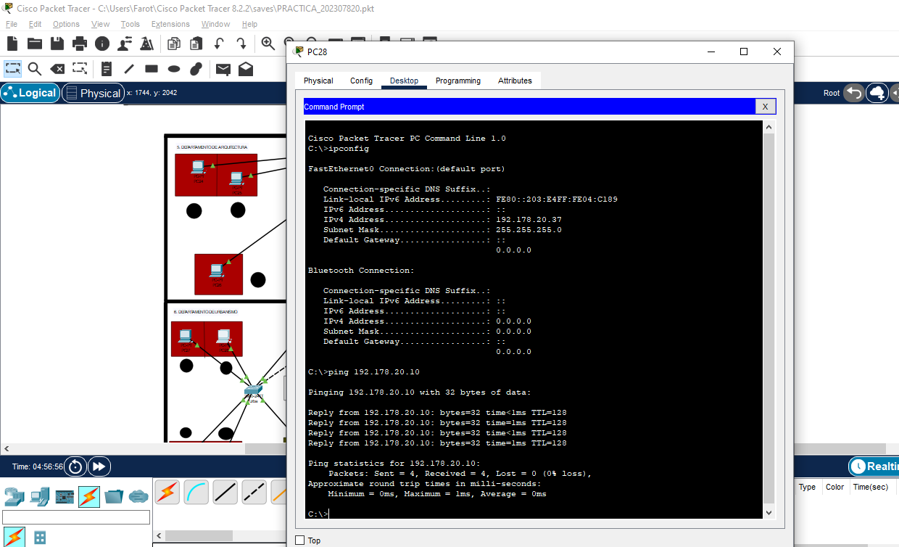

 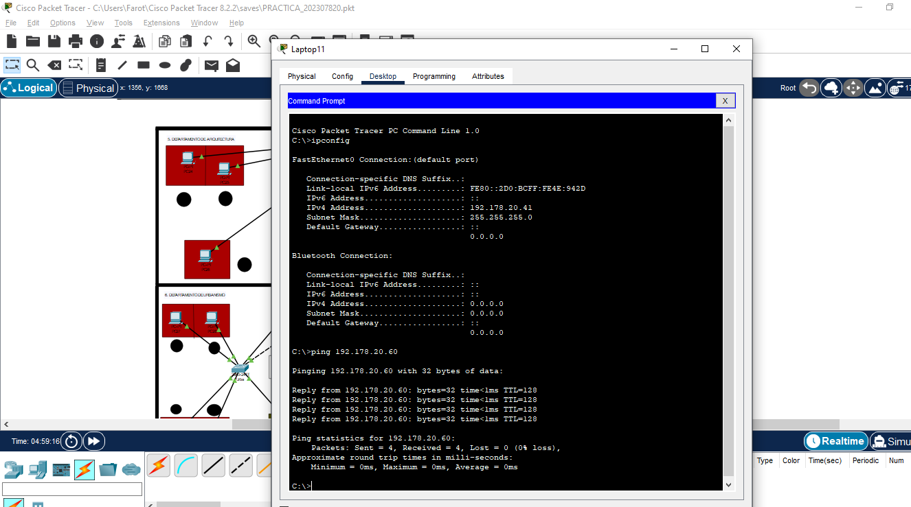

 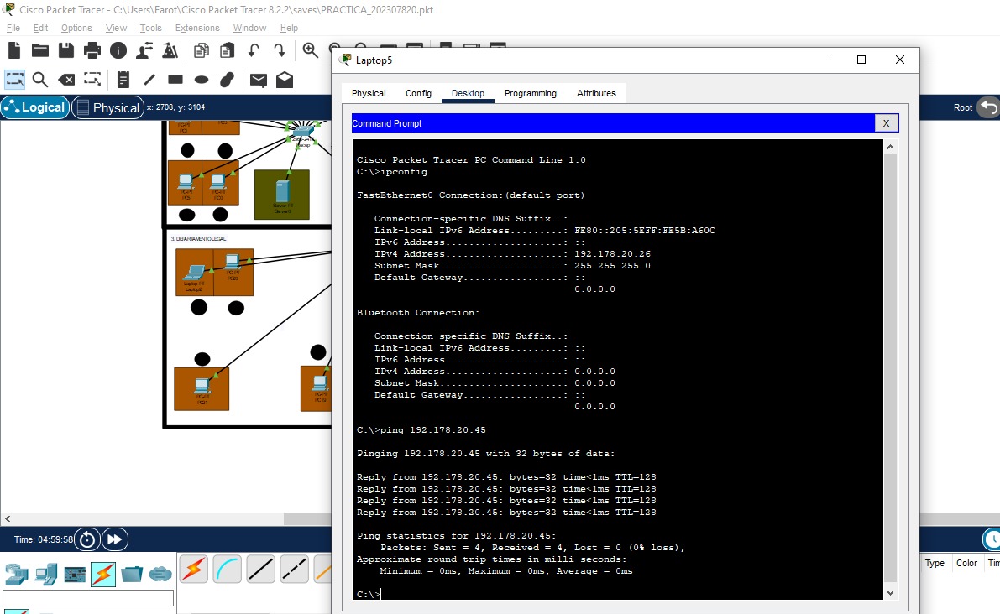

 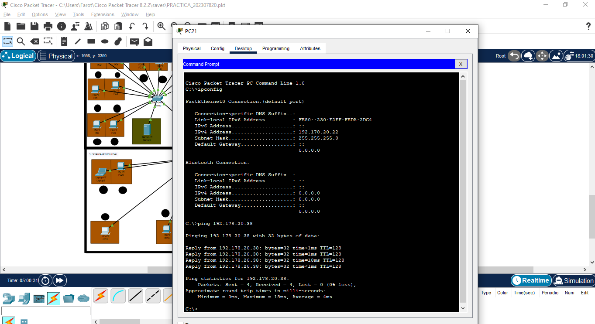

 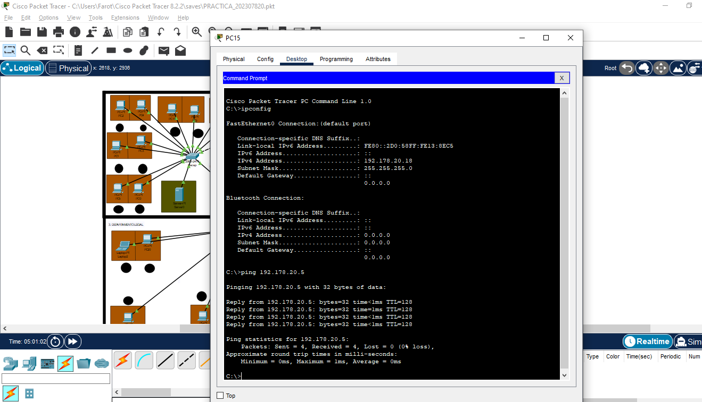

 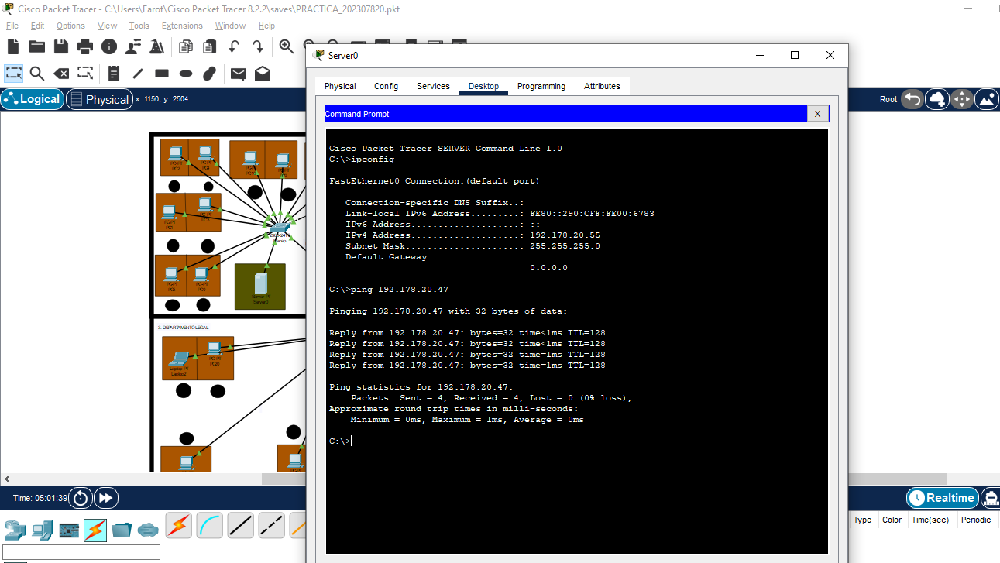

## Capturas de paquete ARP e ICMP en modo simulación

 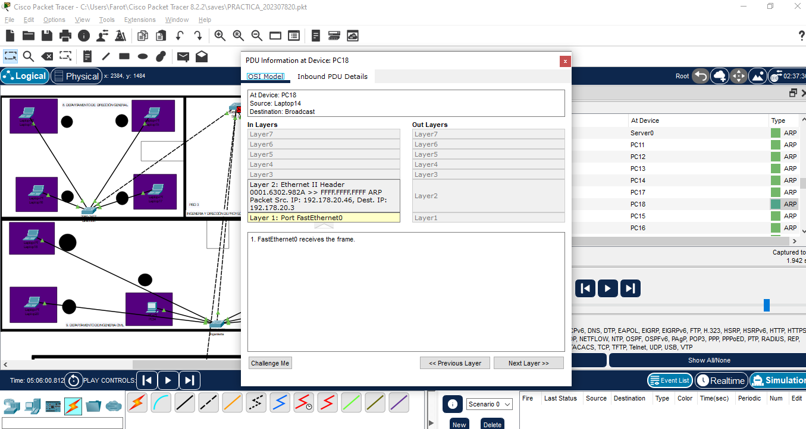

<<<<<<< HEAD
 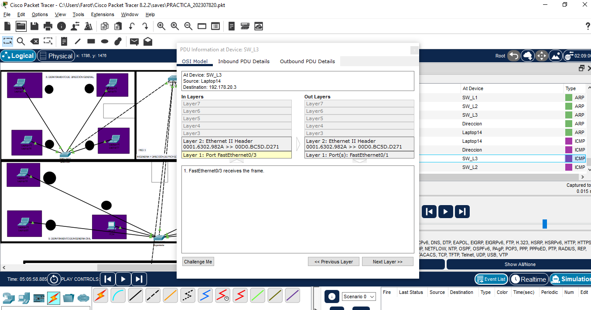

=======
 

>>>>>>> 58a88b79422205a301945c33a6b2b52dba647e84
