UNIVERSIDAD DE SAN CARLOS DE GUATEMALA

FACULTAD DE INGENIERIA

REDES DE COMPUTADORAS

CATEDRÁTICO: ING. ESPINO

============================================================================================

  
  

    <h1 style="color: White; text-decoration: underline; text-decoration-color: black;" >MANUAL TÉCNICO NetCore Academy</h1>
  

============================================================================================

OTTONIEL FABRICIO VÁSQUEZ PINEDA
 
CARNÉ: 202307820
 
SECCIÓN A

GUATEMALA 19 DE MARZO DEL 2026

## Topologías Completas

1. Topología Completa

 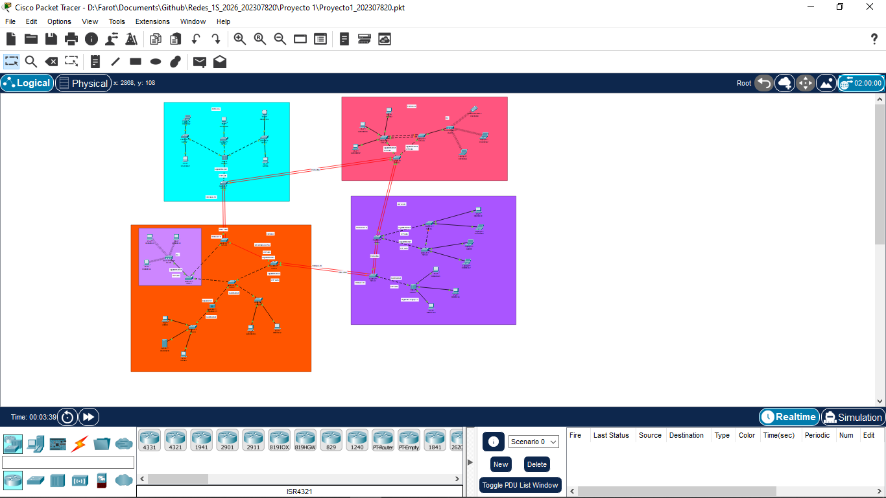

  1.2. Topología por Áreas

* Edificio A:

 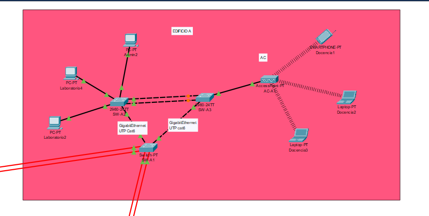

* Edificio B:

 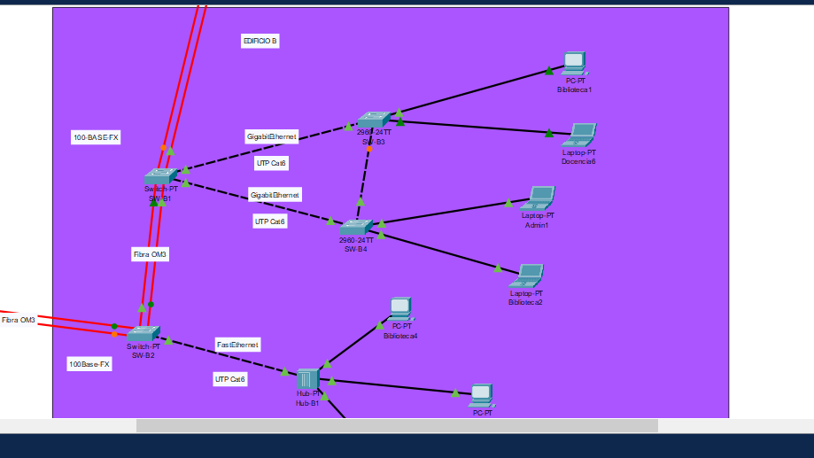

* Edificio C:

 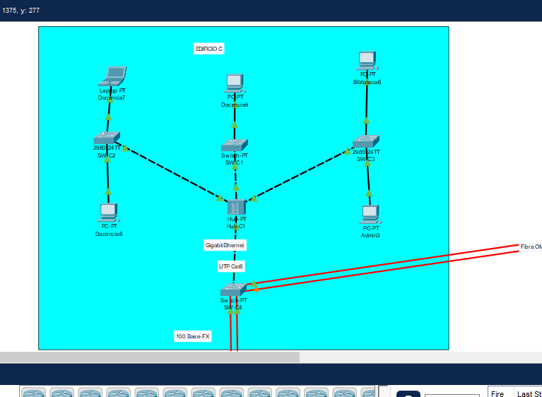

* Eidifcio D:

 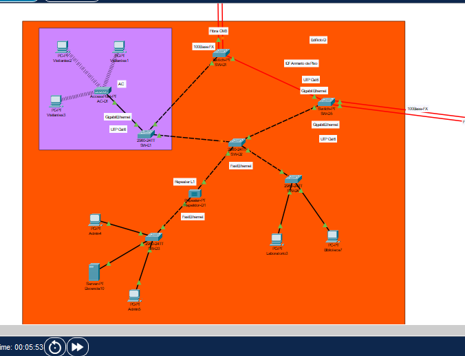

## Segmentos: Interfaces y Medios de Transmisión

| Segmento (Conexión) | Tipo de Interfaz | Medio de Transmisión |
|---------------------|------------------|----------------------|
| Switches Inter-Edificios | GigabitEthernet / FastEthernet | Fibra Óptica |
| Switches Intra-Edificio | GigabitEthernet / FastEthernet | Cable de Cobre (UTP Cat 6) |
| Switch a PCs / Laptops | FastEthernet | Cable de Cobre (UTP Cat 5e/6) |
| Switch a Servidor Web | FastEthernet | Cable de Cobre (UTP Cat 6) |
| Switch a Access Points (APs) | FastEthernet/Port | Cable de Cobre (UTP Cat 6) |
| Switch a Repetidor | FastEthernet/Ethernet | Cable de Cobre (UTP Cat 6) |
| Switch a Hub-PT | GigabitEthernet | Cable de Cobre (UTP Cat 6) |
| Access Point a Laptops/Smartphones | IEEE 802.11 (WLAN) | Ondas de Radio (Inalámbrico) |

   

 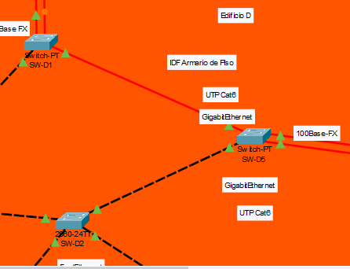

## Tabla de Dominios de Colisión

| Área / Edificio | Cantidad de Dominios | Descripción | 
|-----------------|----------------------|------------- |
| Edificio A | 10 | Puertos de acceso a PCs y troncales a otros switches. |
| Edificio B | 10 | Puertos de acceso a PCs y troncales. |
| Edificio C | 10 | Puertos de acceso y puntos de acceso inalámbricos. |
| Edificio D | 12 | Puertos de Laboratorio, Access Point de Visitantes y troncales. |

 

## Tabla de Dominios de Broadcast

| Área / VLAN | Vlan ID | Nombre | Dominio de Broadcast |
|-------------|---------|--------|----------------------- |
| Administración | 10 | ADMIN | 1 Dominio (Aisla tráfico de Admin) |
| Docencia | 20 | DOCENTES | 1 Dominio (Aisla tráfico de Docentes) |
| Biblioteca | 30 | BIBLIOTECA | 1 Dominio (Aisla tráfico de Biblio) |
| Laboratorio | 40 | LABORATORIO | 1 Dominio (Aisla tráfico de Laboratorios) |
| Visitante | 50 | VISITANTE | 1 Dominio (Aisla tráfico de invitados) |

 

## Comandos integrados

### Switch SW-A1
* enable
* config t
* banner motd # Bienvenido a Edificio [A] - NETCORE_[202307820] #
* vtp domain C2_NetCore
* vtp mode server
* vtp password proyecto12026
* vtp version 2
* vlan 10
* name ADMIN
* exit
* vlan 20
* name DOCENTES
* exit
* vlan 30
* name BIBLIOTECA
* exit
* vlan 40
* name LABORATORIO
* exit
* vlan 50
* name VISITANTE
* exit

! --- STP (Root Bridge) ---
* spanning-tree mode pvst
* spanning-tree vlan 10,20,30,40,50 priority 4096
* do wr
* exit

### Switch clientes
* enable
* configure terminal
* hostname SW-B1  ! (Cambia el nombre según el switch)

! --- VTP Client ---
* vtp domain C2_NetCore
* vtp mode client
* vtp password proyecto12026
* vtp version 2

! --- STP Secundario ---
* spanning-tree mode pvst
* spanning-tree vlan 10,20,30,40,50 priority 28672

! --- Configuración de Puertos de Acceso (Ejemplo) ---
* interface range fa0/1 - 10 (cambia conforme cual sera la salida del puerto)
  -  switchport mode access
  -  switchport access vlan 10  ! (Asigna la vlan que corresponda al área)
  -  no shutdown
* exit

! --- Banner ---
* banner motd # Bienvenido a Edificio B - NETCORE_PAR #
* do wr

### Switch Transparente
* enable
* configure terminal
* hostname E1-Visitantes

! --- VTP Transparent ---
* vtp domain C2_NetCore
* vtp mode transparent
* vtp password proyecto12026
* vtp version 2

! --- Crear VLAN Localmente ---
* vlan 50
 - name VISITANTE
* exit

* interface fa0/1 (cambia conforme los puertos)
* switchport mode trunk
* switchport trunk allowed vlan 10,20,30,40,50
* no shutdown
* exit

* interface g0/1
* switchport mode access
* switchport access vlan 50
* no shutdown
* exit

! --- Banner ---
* banner motd # Bienvenido a Area Visitantes - NETCORE_PAR #
* do wr

### Configuración de EtherChannel

#### LACP 
* interface range fa0/23 - 24 (Cambia a los puertos que se usen)
  - channel-group 1 mode active
  - interface port-channel 1
  - switchport mode trunk
  - switchport trunk allowed vlan 10,20,30,40,50
  - no shutdown

#### PAgP
* interface range fa0/21 - 22 (cambia conforme a los puertos usados)
  - channel-group 2 mode desirable
  - interface port-channel 2
  - switchport mode trunk
  - switchport trunk allowed vlan 10,20,30,40,50
  - no shutdown

### Enlaces Troncales
* interface gigabitEthernet 0/1 (Cambia conforme a los puertos que se utilicen a otros switchs)
  - switchport mode trunk
  - switchport trunk allowed vlan 10,20,30,40,50
  - no shutdown

### verificaciones 
* show vlan brief
* show vtp status
* show interface trunk
* show etherchannel summary
* show spanning-tree summary
* show spanning-tree

## Tabla de IPS asignadas

| Edificio | Nombre Area | Tipo de dispositivos | ips|
|----------|-------------|----------------------|----|
| A | Admin2 | Computadora | 192.168.10.2 |
| A | Docencia1 | Smartphone | 192.168.20.1 |
| A | Docencia2 | Laptop | 192.168.20.2 |
| A | Docencia3 | Laptop | 192.168.20.3 |
| A | Laboratorio2 | Computadora | 192.168.40.2 |
| A | Laboratorio4 | Computadora | 192.168.40.4 |
| B | Admin1 | Laptop | 192.168.10.1 |
| B | Docencia6 | Laptop | 192.168.20.6 |
| B | Biblioteca1 | Computadora | 192.168.30.1 | 
| B | Biblioteca2 | Laptop | 192.168.30.2 |
| B | Biblioteca3 | Computadora | 192.168.30.3 |
| B | Biblioteca4 | Computadora | 192.168.30.4 |
| B | Biblioteca5 | Computadora | 192.168.30.5 |
| C | Admin3 | Computadora | 192.168.10.3 |
| C | Docencia7 | Laptop | 192.168.20.7 |
| C | Docencia8 | Computadora | 192.168.20.8 |
| C | Docencia9 | Computadora | 192.168.20.9 |
| C | Biblioteca6 | Computadora | 192.168.30.6 |
| D | Admin4 | Computadora | 192.168.10.4 |
| D | Admin5 | Computadora | 192.168.10.5 |
| D | Docencia10 | Servidor | 192.168.20.10 |
| D | Biblioteca7 | Computadora | 192.168.30.7 |
| D | Laboratorio3 | Computadora | 192.168.40.3 |
| D | Visitantes1 | Computadora | 192.168.50.1 |
| D | Visitantes2 | Computadora | 192.168.50.2 |
| D | Visitantes3 | Copmutadora | 192.168.50.3 |

 

## Tabla de direccionamiento de VLANS

| ID VLAN | Nombre | Uso / Área |
|---------|--------|----------------------- |
| 10 | ADMIN | Administración |
| 20 | DOCENTES | Docencia |
| 30 | BIBLIOTECA | Biblioteca |
| 40 | LABORATORIO | Laboratorio |
| 50 | VISITANTE | Visitante |

 

## Pruebas de ping 

### ADMIN

 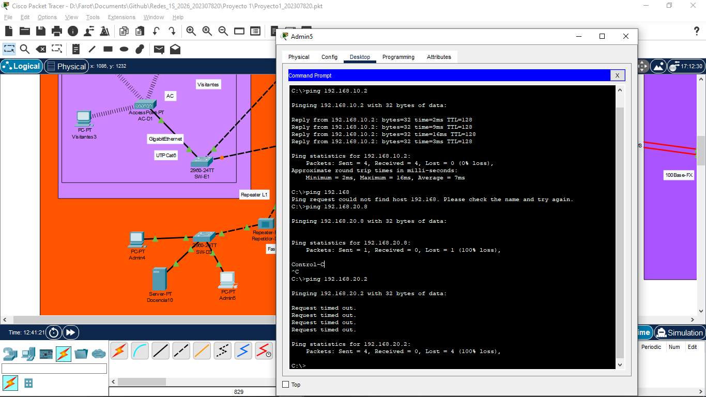

### DOCENCIA

 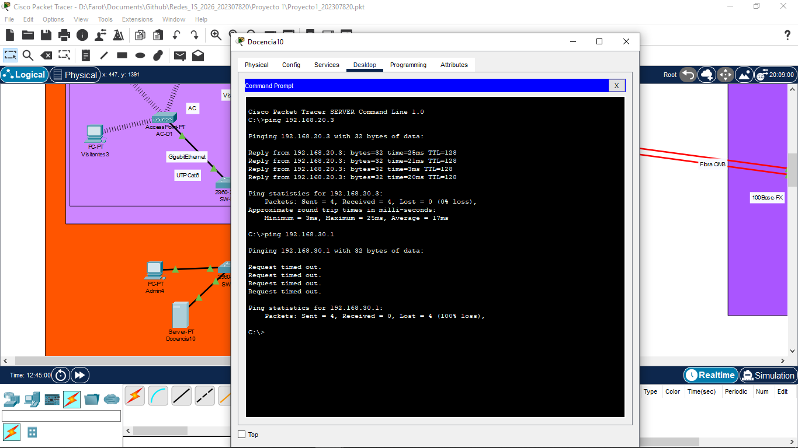

### BIBLIOTECA

 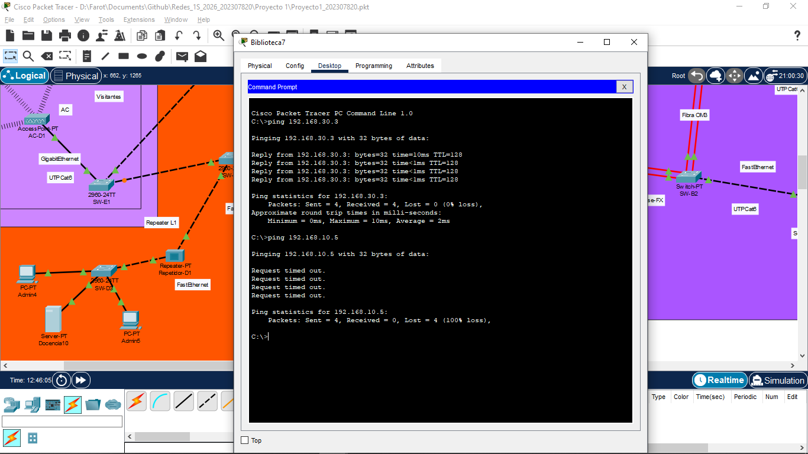

### LABORATORIO

 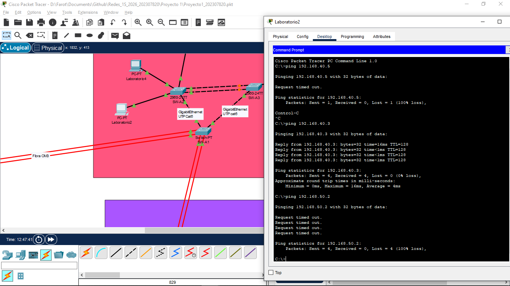

### VISITANTE

 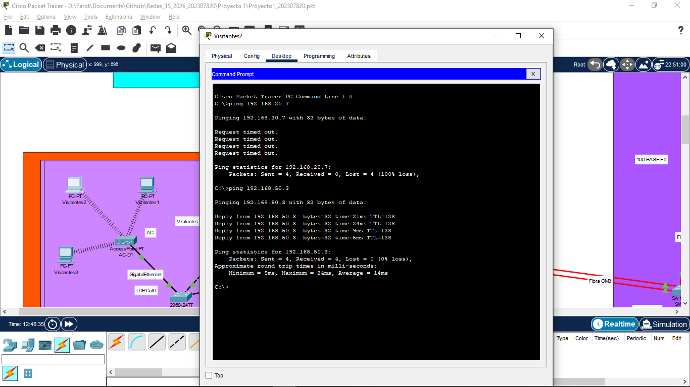

---

   

## Capturas de show spanning-tree

 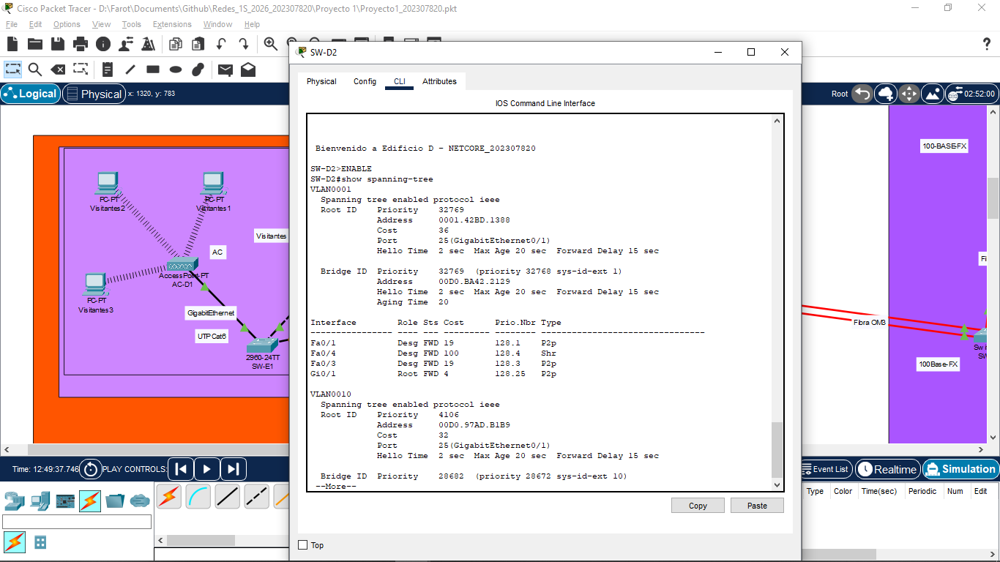

 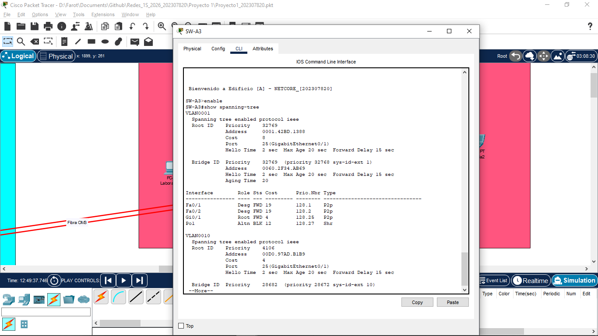

 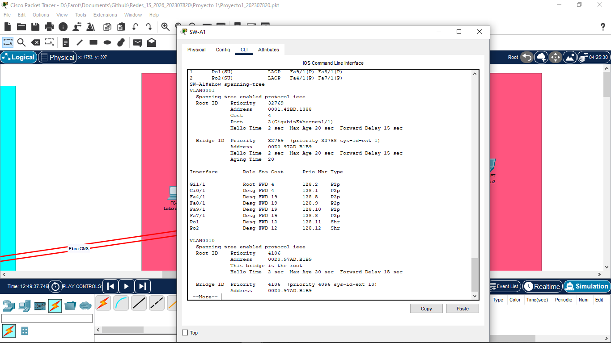

## Capturas de show etherchannel summary

 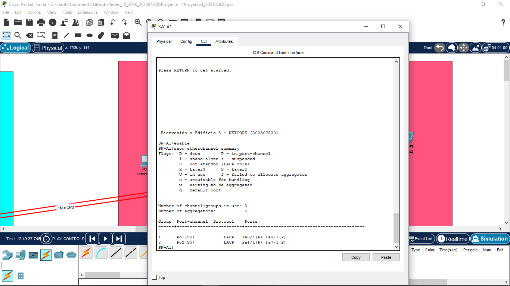

 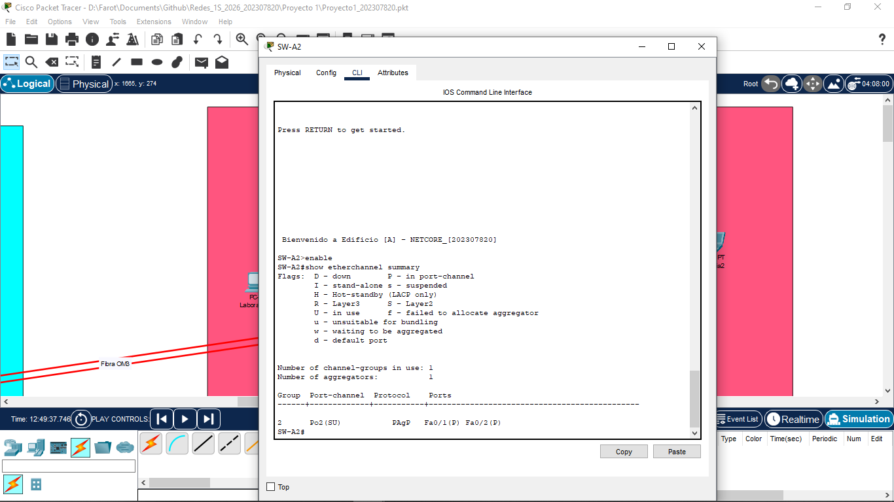

## Capturas de show interface trunk

 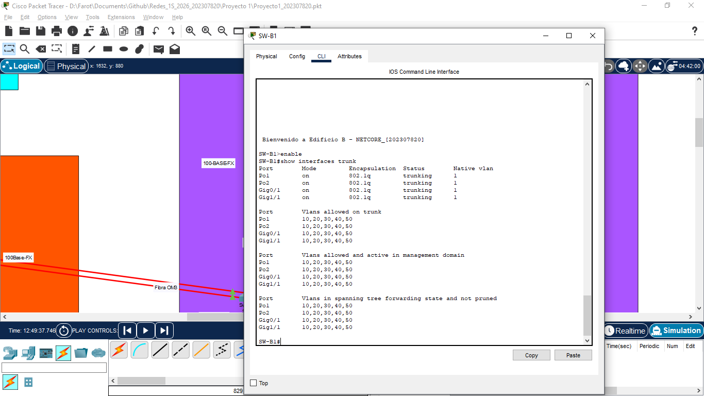

## Presupuesto

### Equipo de Networking (Switches y Acceso)

| Cantidad | Descripción | Precio Unitario | Total |
|----------|-------------|-----------------|-------|
| 9 | Switch Cisco Catalyst 2960-24TT | Q 1,239 | Q 11,151 |
| 8 | Switch-PT | Q 115 | Q 920 |
| 2 | Hub-PT | Q 450 | Q 900 |
| 1 | Repeater-PT | Q 350 | Q 350 |
| 2 | Access Point | Q 1,200 | Q 2,400 |

### Dispositivos Finales

| Cantidad | Descripción | Precio Unitario | Total |
|----------|-------------|-----------------|-------|
| 18 | Computadoras de Escritorio (i5/8GB/SSD) | Q 4,800 | Q 86,400 |
| 6 | Laptops (i5/16GB/SSD) | Q 4,500 | Q 27,000 |
| 1 | Servidor (Xeon/32GB/2TB) | Q 18,500 | 18,500 |
| 1 | Smartphone (Gama Media para pruebas) | 1,800 | 1,800 |

### Cableado y Medios de Transmisión

| Cantidad | Descripción | Precio Unitario | Total |
|----------|-------------|-----------------|-------|
| 4 | Bobinas de Cable UTP Cat6 | Q 1,100 | Q 4,400 |
| 6 | Transceptores SFP 1000BASE-SX (Para Fibra OM3) | Q 450 | Q 2,700 |
| 5 | Jumpers de Fibra Óptica | Q 250 | Q 1,250 |
| 200 | Conectores RJ45 Blindados Cat6 | Q 3 | Q 600 |
