UNIVERSIDAD DE SAN CARLOS DE GUATEMALA

FACULTAD DE INGENIERIA

REDES DE COMPUTADORAS

CATEDRÁTICO: ING. ESPINO

============================================================================================

  
  

    <h1 style="color: White; text-decoration: underline; text-decoration-color: black;" >MANUAL TÉCNICO Infraestructura Financiera y Alta Disponibilidad "BanTech GT"</h1>
  

============================================================================================

OTTONIEL FABRICIO VÁSQUEZ PINEDA
 
CARNÉ: 202307820
 
SECCIÓN A

GUATEMALA 29 DE Abril DEL 2026

## Infraestructura del Basckbone
El Backbone de BanTech GT constituye el núcleo de transporte de alta disponibilidad que interconecta las sedes regionales y el centro de datos. Se ha diseñado bajo un modelo jerárquico que garantiza la redundancia y la seguridad de los servicios críticos.

### Componentes principales
- Capa de Enrutamiento (Core): Conformada por tres routers principales (R1-CENTRAL, R2-NOR-OCC, R3-ORIENTE) que gestionan la interconectividad entre los distintos dominios de enrutamiento (OSPF, EIGRP, RIPv2).

- Capa de Distribución de Núcleo: Integrada por dos switches multicapa (SW-CORE-1 y SW-CORE-2) que proporcionan el transporte de alta velocidad para el tráfico transaccional.

- Segmento de Alta Seguridad: Un área aislada compuesta por el switch SW-CRITICO-SRV y el servidor SRV-AUTH-GATEWAY, gestionada exclusivamente mediante rutas estáticas.

### Tabla de direccionamiento Lógico (Backbone)
| Dispositivo | Interfaz | Dirección IP | Función | 
|-------------|-----------|----------|------------|
| R1-CENTRAL | GI1/0 | 10.50.50.1/24 | Gateway del Segmento Crítico |
| R1-CENTRAL | Gi0/0 | 10.20.1.2/30 | Enlace hacia SW-CORE-1 |
| R1-CENTRAL | Lo0 | 172.16.1.1/24 | Router ID y Gestión |
| R2-NOR-OCC | Gi0/0 | 10.20.2.1/30 | Enlace hacia SW-CORE-2 |
| SW-CORE-1 | Gi1/1/3 | 10.20.1.1/30 | Enlace hacia R1-CENTRAL |
| SW-CORE-1 | Port-Channel 1(G1/1/1 y G1/1/2) | 10.10.10.1/30 | Enlace Ethernet-Channel 1 hacia SW-CORE-2 |
| SW-CORE-2 | Port-Channel 1 (G1/1/1 y G1/1/2) | 10.10.10.2/30 | Enlace Ethernet-Channel 1 hacia SW-CORE-1 |
| SW-CORE-2 | Gi1/1/3 | 10.20.2.2/30 | Enlace hacia R2-NOC-OCC
| R3-ORIENTE | Gi0/0 | 10.0.0.1/30 | Gateway Sede Oriente (G0/0) | 
| R3-ORIENTE | Se2/0 | 10.20.4.2/30 | Enlace WAN Serial |
| SRV-AUTH-GATEWAY | NIC | 10.50.50.100 | Servidor de Autenticación | 

### Configuración de Dispositivos de Núcleo
1. R1-CENTRAL (Router de Borde y Servicios Críticos)
Este router actúa como el punto central de redistribución de la red
     * Procolos Activos: OSPF (Area 0) y EIGRP (AS 10)
     * Resdistribución: Configurada para inyectar rutas EIGRP, rutas estáticas y redes conectadas dentro del dominio OSPF. Esto garantiza que todo el banco vea el segmento de servidores.
     * Segmento de seguridad: La interfaz Gi1/0 (10.50.50.1) está aislada físicamente para el SRV-AUTH-GATEWAY.

2. R2-NOR-OCC (Frontera Norte y Occidente):
Es el router encargado de unir las sedes regionales con el centro..
     * Protocolos Activos: OSPF y EIGRP.
     * Manejo de VLANs: Utiliza el método Router-on-a-Stick con subinterfaces (10, 20, 30, 40, 50, 60, 70) para gestionar el ruteo inter-vlan de la Sede Norte y Occidente.

3. R3-ORIENTE (Frontera Regional Oriente):
Gestiona la transición entre el núcleo OSPF, la red regional EIGRP y el legado RIP.
     * Redistribución: Es el punto más complejo, realizando redistribución recíproca entre RIP, OSPF y EIGRP.
     * Conectividad: Posee el enlace Serial WAN hacia el Core, cumpliendo con el requerimiento de diversidad de medios físicos.

### Capa de Distribución (SW-CORE-1 y SW-CORE-2)
1. Agregación de Enlaces (EtherChannel):

     Se ha implementado EtherChannel (Port-Channel 1) entre los switches de núcleo para proporcionar un ancho de banda de 2Gbps.

     - Protocolo: Configurado en modo ON para asegurar estabilidad.
     - Redundancia L2: El protocolo PVST+ está activo, con SW-CORE-1 y SW-CORE-2 actuando como puentes raíz para la VLAN 1, garantizando un tiempo de convergencia mínimo.

2. Enlaces troncales

     Los puertos asociados al Port-Channel 1 están configurados como Trunks 802.1Q, permitiendo el paso de todas las VLANs (1-1005) a través del núcleo del backbone.

### Rol de los Protocolos en BanTech GT

* OSPF (Open Shortest Path First): Utilizado como el protocolo de estado de enlace principal en el núcleo. Su rol es garantizar la convergencia inmediata entre los routers centrales (R1, R2, R3) y los switches multicapa, permitiendo que el tráfico transaccional encuentre siempre la ruta más corta y rápida.

* EIGRP (Enhanced Interior Gateway Routing Protocol): Implementado para la expansión regional en la Sede Oriente. Se eligió por su facilidad de configuración en entornos Cisco y su capacidad de manejar métricas compuestas, ideal para enlaces de diferentes velocidades.

* RIPv2 (Routing Information Protocol): Utilizado exclusivamente para la comunicación con la sede de red legada (Occidente), permitiendo la interoperabilidad con sistemas antiguos sin comprometer la seguridad del resto del backbone.

* Rutas Estáticas: Reservadas para el segmento de Alta Seguridad. Su rol es preventivo: evitar que el servidor de autenticación sea "anunciado" dinámicamente, asegurando una ruta fija y controlada que no dependa de algoritmos de ruteo.
 

### Justificación de la topología y Diseño
Topología física: Se ha implementado una topología de Malla Parcial en el núcleo.

- Ventaja de Tolerancia a Fallos: La interconexión entre los routers de núcleo permite que, ante la caída de un enlace principal (como el enlace serial o de fibra), el tráfico sea redireccionado automáticamente a través de los caminos alternos gestionados por los protocolos dinámico

- Respuesta Operativa: Esta estructura permite que las ráfagas de tráfico provenientes de la Sede Oriente y Occidente no saturen un único punto de entrada, distribuyendo la carga hacia el Data Center de manera eficiente.

Segmento de Alta Seguridad (Rutas Estáticas): El segmento que conecta al SRV-AUTH-GATEWAY se mantiene fuera de los dominios de enrutamiento dinámico.

- Justificación: El uso de rutas estáticas en este punto garantiza que solo el tráfico explícitamente definido pueda alcanzar el servidor de autenticación, reduciendo la superficie de ataque y evitando que fallos en la convergencia de OSPF o EIGRP afecten la disponibilidad del servicio más crítico del banco.

### Tolerancia a fallas

Esta configuración responde a la necesidad operativa de disponibilidad "cinco nueves" (99.999%) del banco. Al tener los routers interconectados entre sí y hacia los Switches Core, la falla de un dispositivo o un cable (como el enlace Serial de R3) no aisla a ninguna sede, ya que los protocolos dinámicos y los enlaces físicos redundantes proveen caminos alternos instantáneos.

### Cumplimiento de Necesidad Operativa
El diseño integra EtherChannel entre SW-CORE-1 y SW-CORE-2 para eliminar cuellos de botella en la comunicación entre el Data Center y el NOC. Esto permite que el flujo masivo de datos de las transacciones bancarias no se vea limitado por la capacidad de un solo cable físico.

### Topología del Backbone

 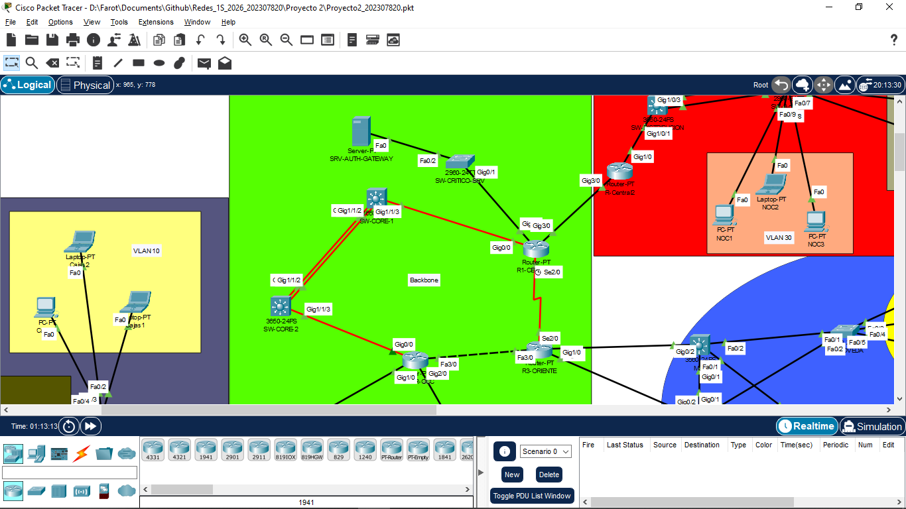

### Configuraciones del Backbone

#### Switch Core1

 

 

 

 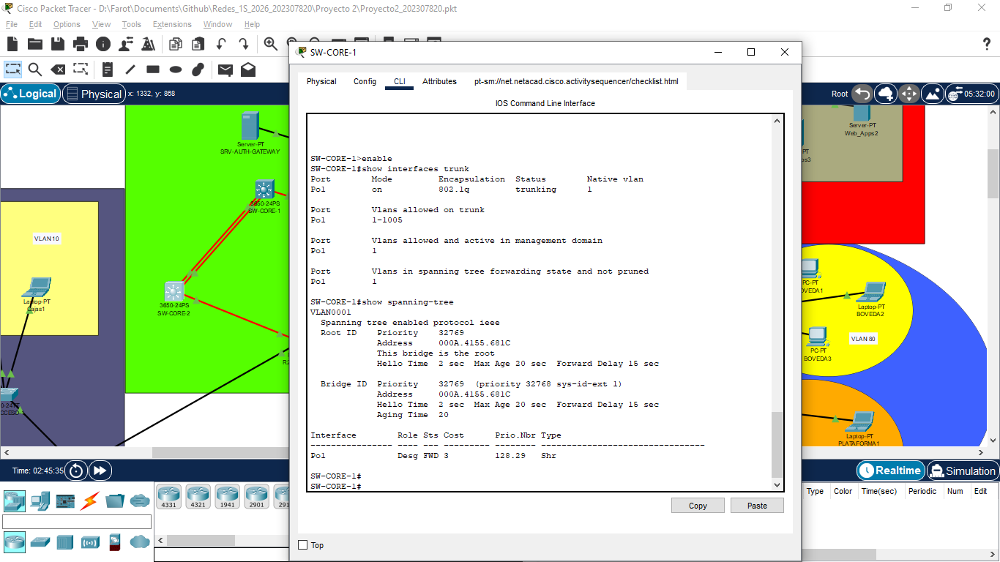

#### Switch Core2

 

 

 

 

#### Router1

 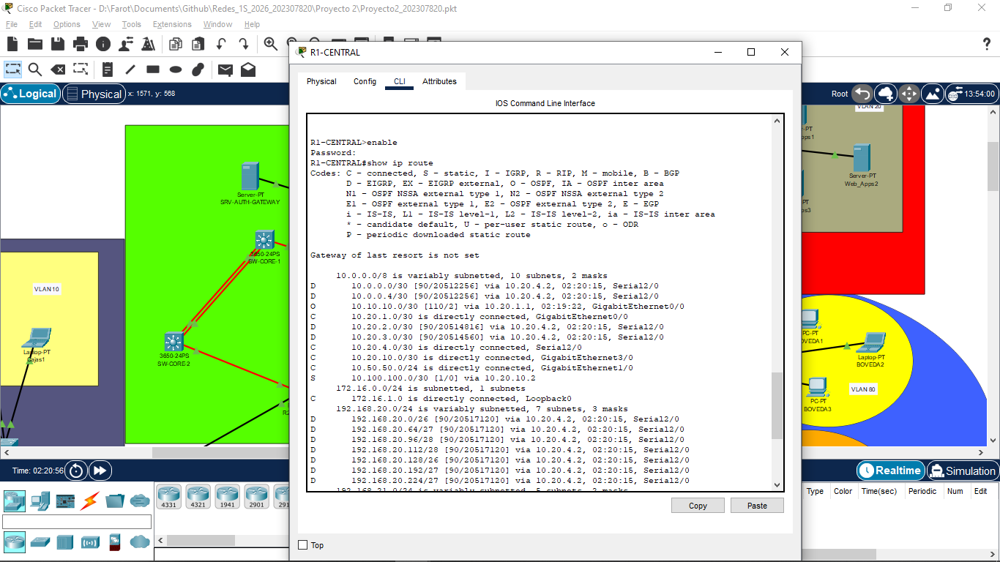

 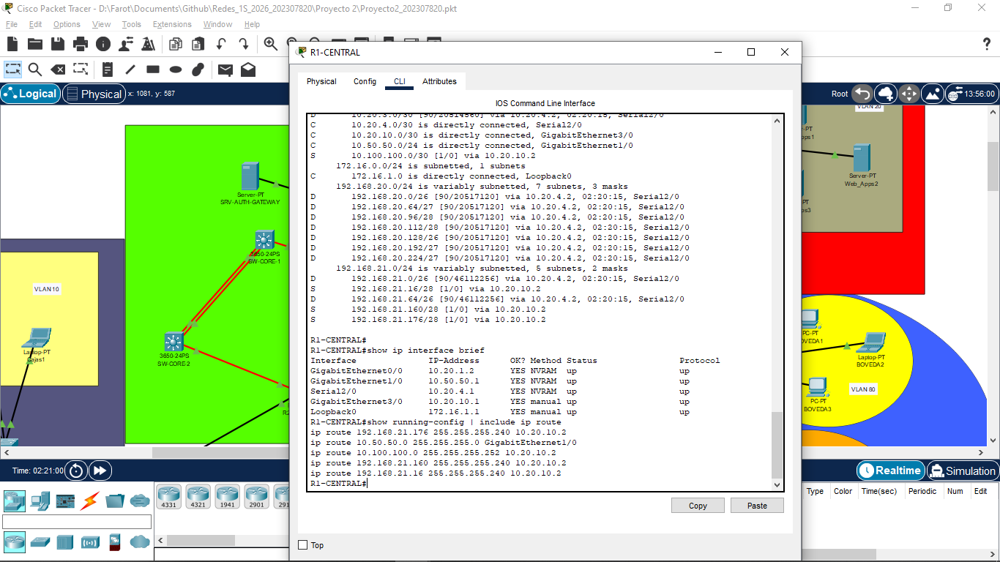

 

 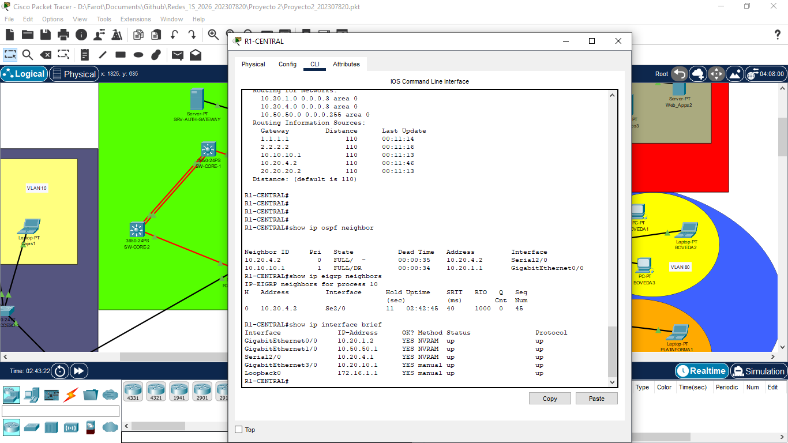

#### Router 2

 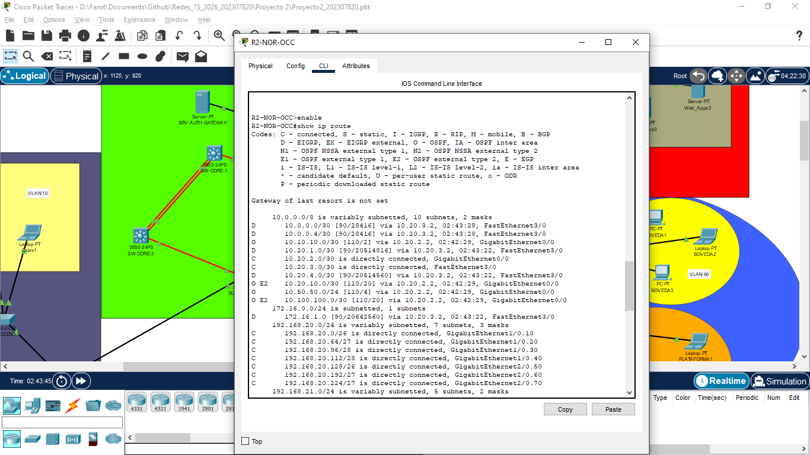

 

 

#### Router 3

 

 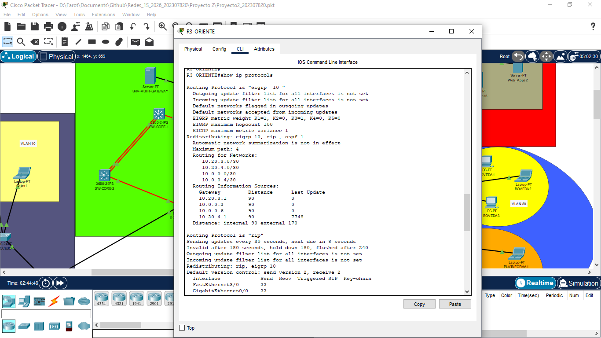

 

 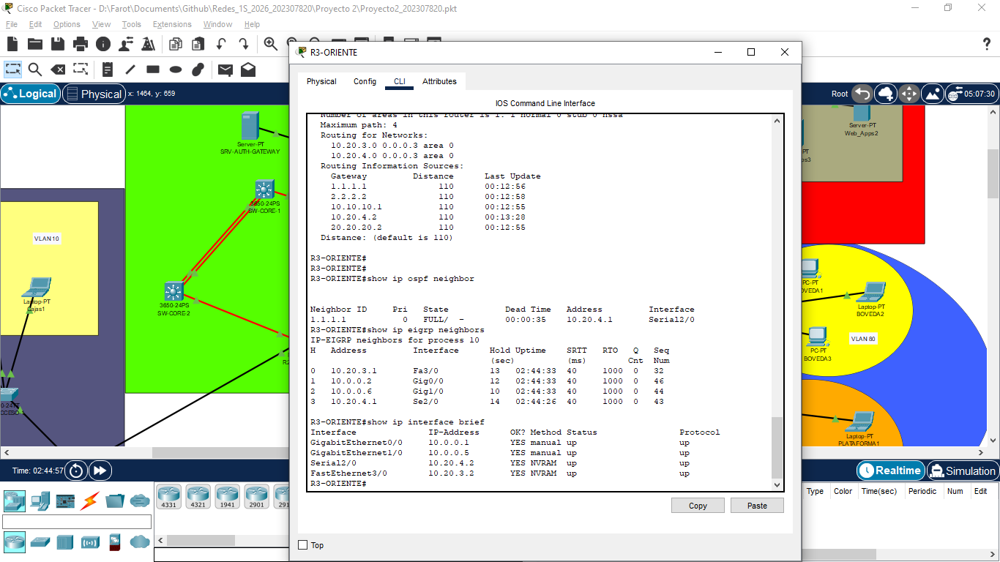

## 1. Sede Occidente (Agencia Regional Comercial)

### Justificación de Arquitectura

Se ha implementado una topología de Estrella Extendida con un diseño de Router-on-a-Stick. Esta elección responde a la necesidad de una agencia comercial de alto tráfico por las siguientes razones:

* Eficiencia en Segmentación: Al separar Cajas, Asesores, Gerencia y Seguridad en VLANs distintas, se garantiza que el tráfico crítico de transacciones (VLAN 10) no compita por recursos con el tráfico de cámaras de seguridad o navegación administrativa.

* Alta Manejabilidad (VTP): La implementación de VTP permite que la administración de las 4 VLANs se realice centralizadamente desde el SW-OCC-SERVER. Los switches de acceso actúan como clientes, asegurando que la base de datos de VLANs sea idéntica en toda la sede, evitando errores de configuración manual.

* Tolerancia a Fallos: El uso de enlaces Trunk (802.1Q) asegura que, si un área funcional crece y necesita moverse de un switch a otro, la conectividad se mantenga sin cambios en la arquitectura lógica.

### Mapeo Lógico y Roles de Dispositivos

| Dispositivo | Rol | Estado VTP | Conectividad Troncal |
|-------------|-----|------------|----------------------|
| R2-NOR-OCC | Gateway (Inter-VLAN) | N/A | Subinterfaces Gi1/0.10 - .40 |
| SW-OCC-SERVER | Switch de Distribución | Server | Fa0/1, Fa0/2, Gig0/1 |
| SW-ACCESO-1 | Switch de Acceso | Client | Fa0/1 (hacia Distribución) |
| SW-ACCESO-2 | Switch de Acceso | Client | Fa0/2 (hacia Distribución) |

### Tabla de Direccionamiento y VLANs (VLSM)

| VLAN | Nombre | ID | Gateway | Rango útil | Asignación de Puertos (Acceso)|
|------|----------|--|------|-----------|----------------| 
| 10 | Cajas | 192.168.20.0/26 | 192.168.20.1 | .2 - .62 | SW-ACCESO-1: Fa0/2, Fa0/3, Fa0/4 |
| 20 | Asesores | 192.168.20.64/27 | 192.168.20.65 | .66 - .94 | SW-ACCESO-1: Fa0/5, Fa0/6, Fa0/7 |
| 30 | Gerencia | 192.168.20.96/28 | 192.168.20.97 | .98 - .110 | SW-ACCESO-2: Fa0/1, Fa0/3, Fa0/4 |
| 40 | Seguridad | 192.168.20.112/28 | 192.168.20.113 | .114 - .126 | SW-ACCESO-2: Fa0/5, Fa0/6, Fa0/7 |

### Topología del Occidente

 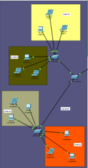

### Configuraciones de la sede Occidente

#### Router 2

 

 

#### Switch Server

 

 

#### Switch Accesos 1

 

 

#### Switch Accesos 2

 

 

## 2. Sede Norte (Centro de Autorización de Créditos)

### Justificación de Arquitectura

Para garantizar que el Centro de Autorización de Créditos no sufra interrupciones, se ha diseñado una topología de Triángulo de Alta Disponibilidad utilizando tres switches interconectados.

* Redundancia Física: El diseño incluye bucles intencionales entre SW-NORTE-ROOT, SW-NORTE-2 y SW-NORTE-3. Si el enlace principal entre el switch de analistas y el root falla, los datos fluyen automáticamente a través del tercer switch en milisegundos.

* Protocolo Rapid PVST+: Se seleccionó para obtener tiempos de convergencia casi instantáneos. Como se observa en la consola, el estado de los puertos pasa a FWD (Forwarding) de manera optimizada, evitando las pausas de 30-50 segundos del STP clásico.

* Determinismo con Root Bridge: Se configuró manualmente la prioridad de SW-NORTE-ROOT en 24576 (más el ID de VLAN) para forzarlo como el puente raíz. Esto asegura que el tráfico siempre fluya hacia el switch que tiene la conexión directa al router R2-NOR-OCC, reduciendo la latencia.

### Mapeo Lógico y Roles de STP

| Dispositivo | Rol Jerárquico | Protocolo | Estado STP | Prioridad (Configurada) |
|-------------|----------------|-----------|------------|-------------------------|
| SW-NORTE-ROOT | Distribución | Rapid PVST | ROOT BRIDGE | 24576 + ID_VLAN |
| SW-NORTE-2 | Acceso (Analistas/Legal) | Rapid PVST | Designated/Root | 32768 + ID_VLAN |
| SW-NORTE-3 | Acceso (Auditoría) | Rapid PVST | Designated/Root | 32768 + ID_VLAN |

### Tabla de Direccionamiento y VLANs (Centro de Créditos)

| VLAN | Área Funcional | ID de Red | Gateway | Rango Útil | Puertos Asignados |
|-----|-----------------|----------|---------|--------------|------------------|
| 50 | Análisis | 192.168.20.128/26 | 192.168.20.129 | .130 - .190 | SW-NORTE-2: Fa0/3, 0/4, 0/5 |
| 60 | Auditoría | 192.168.20.192/27 | 192.168.20.193 | .194 - .222 | SW-NORTE-3: Fa0/3, 0/4, 0/5 |
| 70 | Legal | 192.168.20.224/27 | 192.168.20.225 | .226 - .254 | SW-NORTE-2: Fa0/6, 0/7; SW-NORTE-3: Fa0/6 |

### Topología de la Sede Norte

 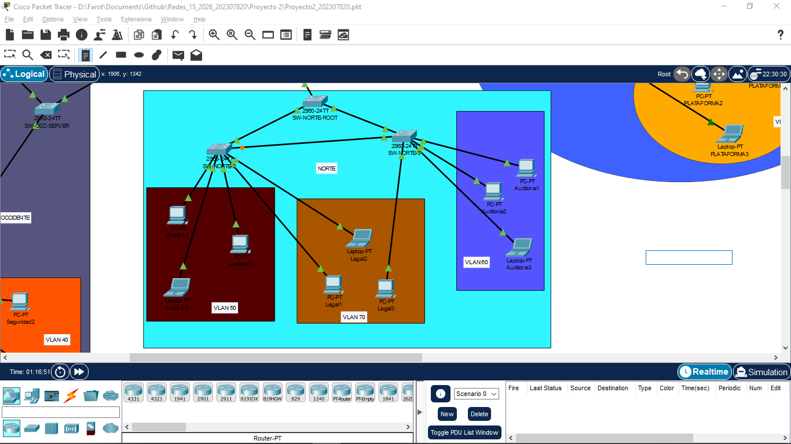

### Configuración de la Sede Norte

#### Router 3

 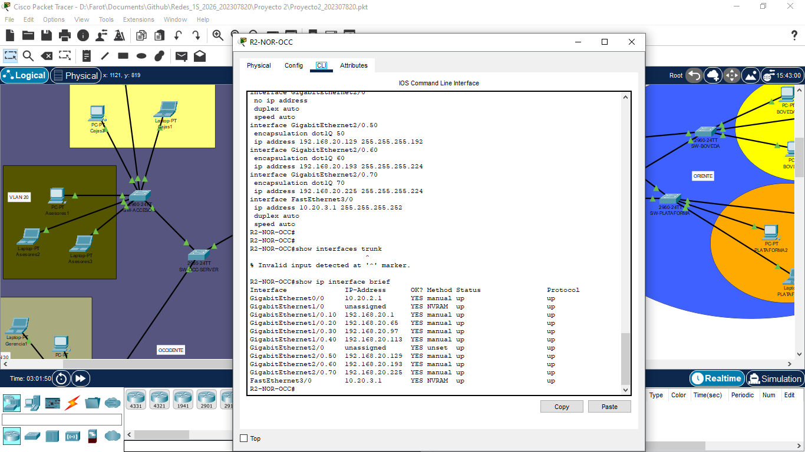

#### Switch Root

 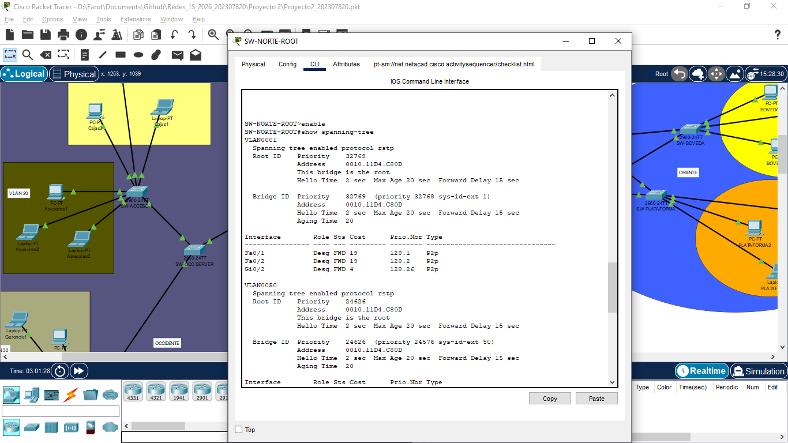

 

 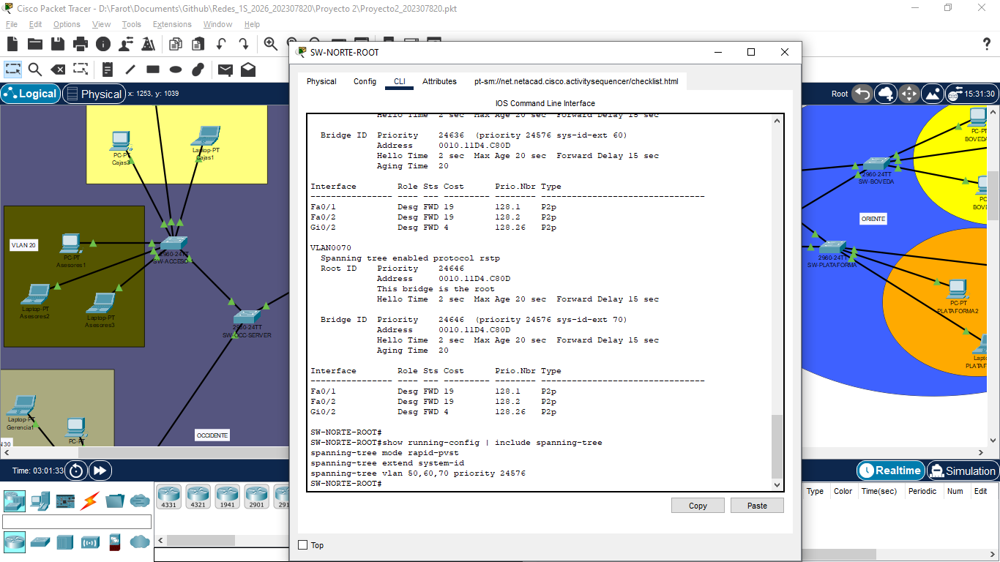

 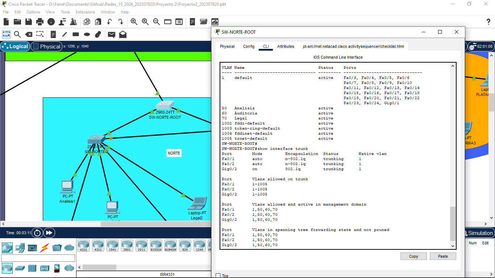

#### Switches no root

 

 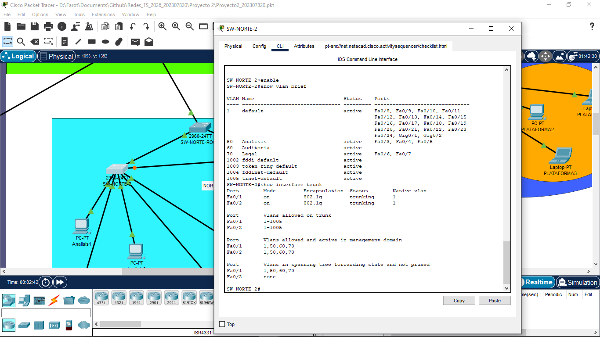

 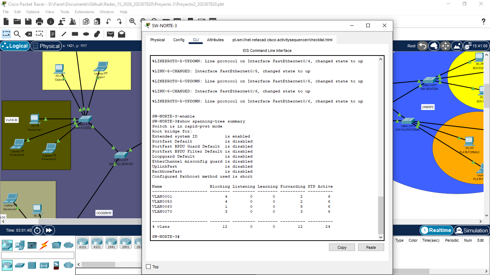

 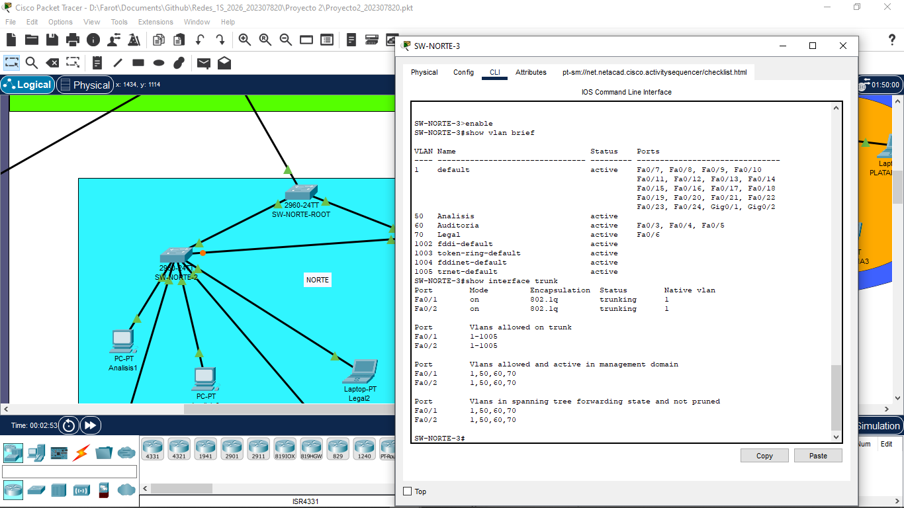

## 3. Sede Oriente (Centro Financiero Legado)

### Justificación de Arquitectura

La Sede Oriente representa el núcleo corporativo legado del banco. Para cumplir con la exigencia de "cero pérdida de conectividad", se ha implementado una infraestructura de Core Colapsado Redundante:

* Redundancia de Primer Salto (HSRP): Se utiliza el protocolo HSRP para crear un "Gateway Virtual". Las estaciones de trabajo apuntan a una IP única, pero el servicio es provisto por dos switches multicapa físicos. Si MS1 falla, MS2 asume la IP virtual.

* Dual-Homing (Doble Conexión): Los switches de acceso (SW-BOVEDA y SW-PLATAFORMA) poseen enlaces troncales activos hacia ambos switches multicapa. Esto elimina cualquier punto único de falla en el cableado vertical.

* Segmentación Corporativa: Se definieron VLANs específicas para separar las operaciones de valores (Bóveda) de la atención al cliente (Plataforma), manteniendo la integridad de los datos financieros legados.

* Interconexión de Capa 3: Se utilizan enlaces ruteados hacia el router R3-ORIENTE mediante direccionamiento /30 (10.0.0.0/30 y 10.0.0.4/30), permitiendo que el backbone utilice protocolos de ruteo dinámico para elegir el mejor camino hacia el núcleo nacional.

### Mapeo Lógico de Redundancia (HSRP)

| Parámetro | VLAN 80 (Bóveda) | VLAN 90 (Plataforma) |
|-----------|------------------|----------------------|
| IP Virtual (Gateway) | 192.168.21.1 | 192.168.21.65 |
| Rol MS1 | Activo (Prioridad 110) | Activo (Prioridad 110) |
| Rol MS2 | Standby (Prioridad 100) | Standby (Prioridad 100) |
| Preemption | Habilitado (MS1) | Habilitado (MS1) |

### Tabla de Direccionamiento y VLANs (Sede Oriente)

| VLAN | Área Funcional | Gateway Virtual | IP Física MS1 | IP Física MS2 | Rango útil |
|------|----------------|-------------------|-------------|---------------|-------------|
| 80 | Bóveda | 192.168.21.1 | 192.168.21.2 | 192.168.21.3 | .4 - .62 |
| 90 | Plataforma | 192.168.21.65 | 192.168.21.66 | 192.168.21.67 | .68 - .126 |

### Topología de la Sede Oriente

 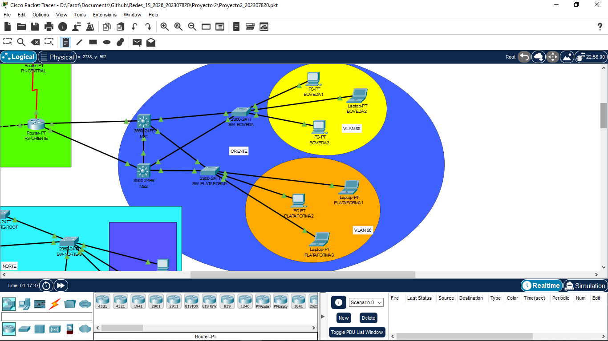

### Configuraciones de la Sede Oriente

#### Router

 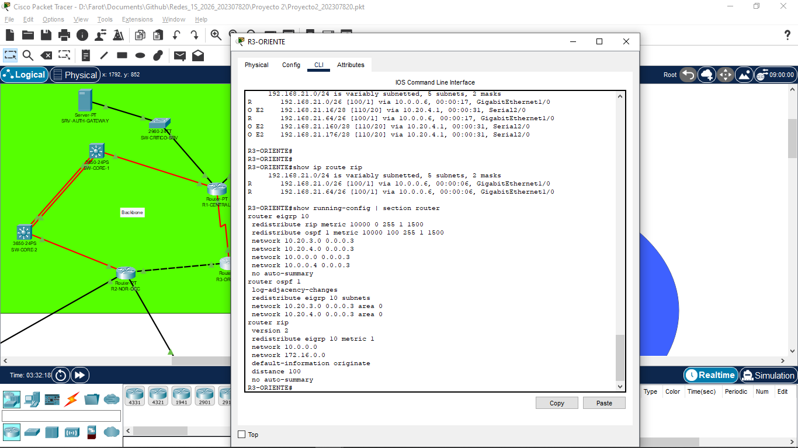

#### Switch MS1

 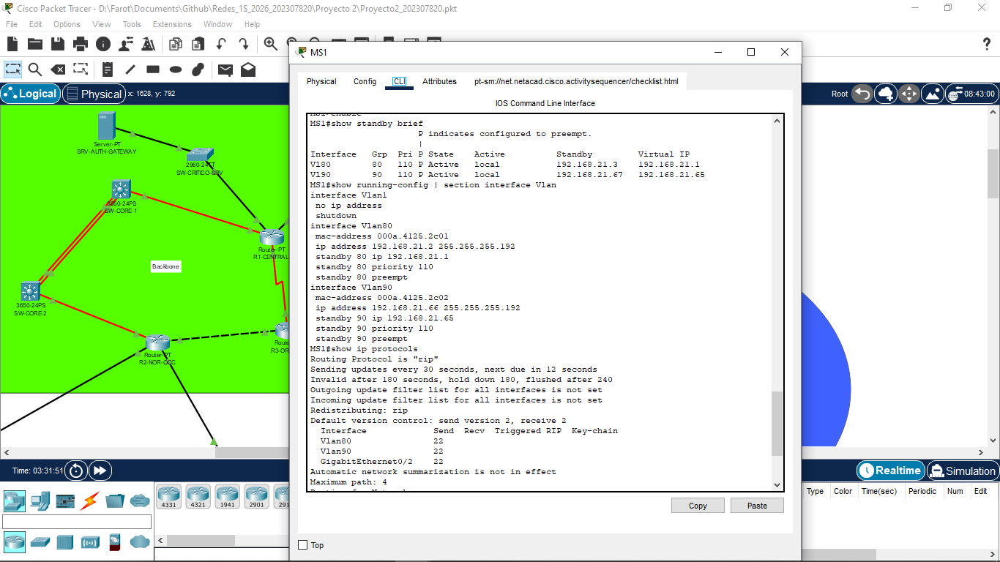

#### Switch MS2

 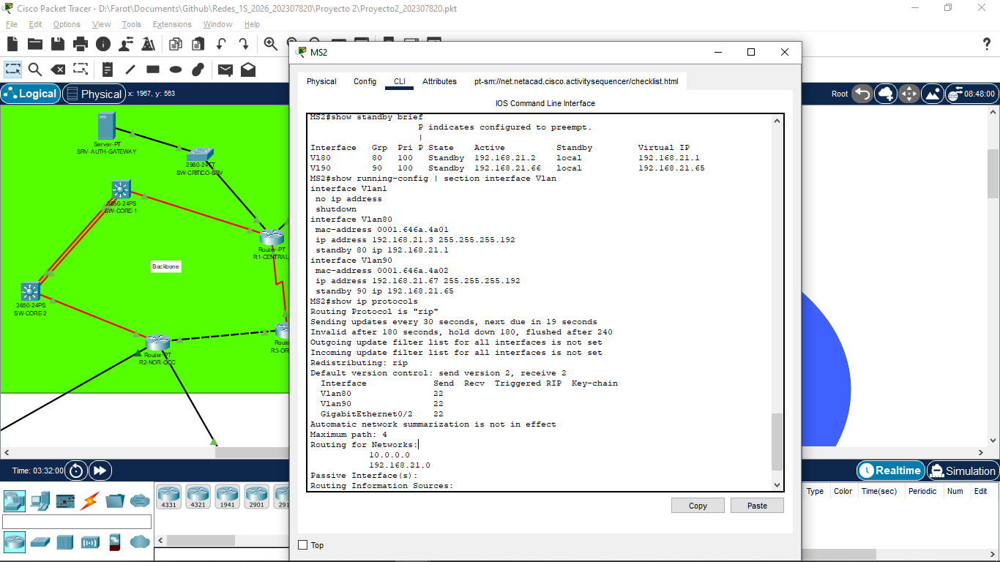

#### Switch Boveda

 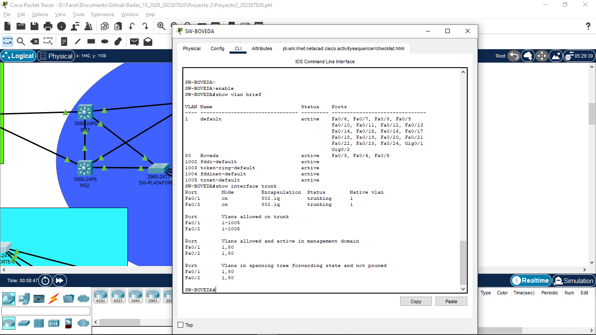

#### Switch Plataforma

 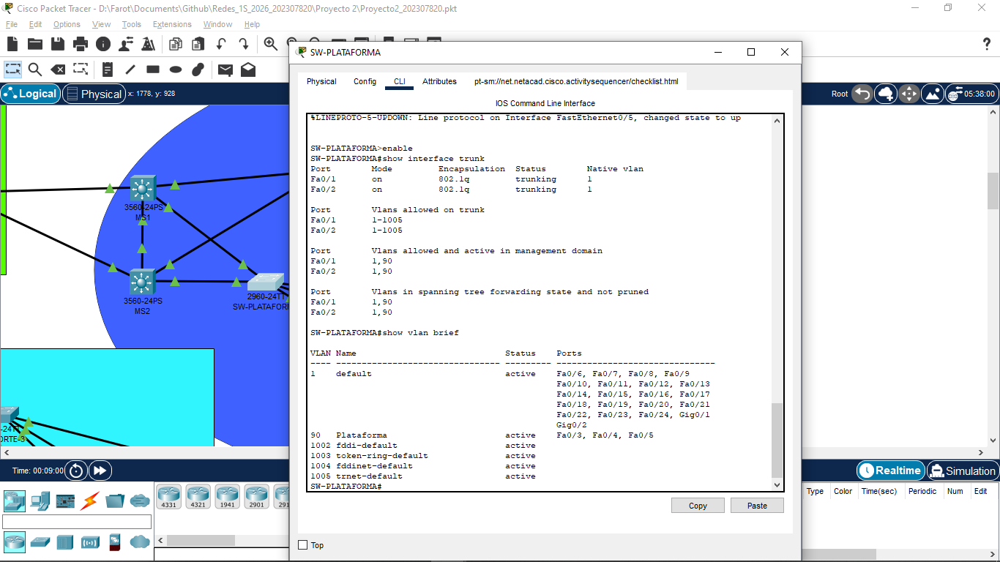

## 4. Data Center y Sede Central (Alta Seguridad)

### Justificación de Arquitectura

El Data Center se ha diseñado bajo un esquema de aislamiento controlado y alto rendimiento de capa 2, garantizando que los servicios de banca virtual y bases de datos operen sin cuellos de botella.

* Agregación de Enlaces (EtherChannel): Se implementó LACP (Link Aggregation Control Protocol) entre los switches de distribución y acceso. Como se observa en la consola, el ancho de banda se ha duplicado a 2000Mb/s (2 Gbps), permitiendo manejar las ráfagas de tráfico masivo entre servidores.

* Redistribución de Rutas (Seguridad Perimetral): Para proteger la integridad del Data Center, se utiliza enrutamiento estático interno. El router R1-CENTRAL actúa como frontera (ASBR), inyectando estas rutas estáticas dentro del proceso OSPF 1. Esto permite que el resto del banco llegue al Data Center sin que el Data Center necesite procesar toda la tabla de ruteo dinámica del backbone.

* Segmentación Estricta: Las VLANs (10, 20, 30) separan físicamente los servidores de base de datos del tráfico de monitoreo (NOC), cumpliendo con estándares de seguridad financiera.

### Mapeo de EtherChannel (LACP)

| Port-Channel | Interfaces físicas | Protocolo | Estado |
|--------------|--------------------|-----------|--------|
| Po1 | Gig1/0/2, Gig1/0/3 | LACP | SU (En uso) |

### Tabla de Direccionamiento y VLANs (Data Center) 

| VLAN | Área Funcional | ID de Red | Gateway | Rango útil | Puertos (Acceso) |
|------|-------------|--------------|---------|--------------|----------------|
| 10 | Core_BD | 192.168.21.16/28 | 192.168.21.17 | .18 - .30 | Fa0/1 - Fa0/3 |
| 20 | Web_Apps | 192.168.21.144/27 | 192.168.21.161 | .146 - .174 | Fa0/4 - Fa0/6 |
| 30 | NOC | 192.168.21.176/28 | 192.168.21.33 | .178 - .190 | Fa0/7 - Fa0/9 | 

### Topología de la Data Center

 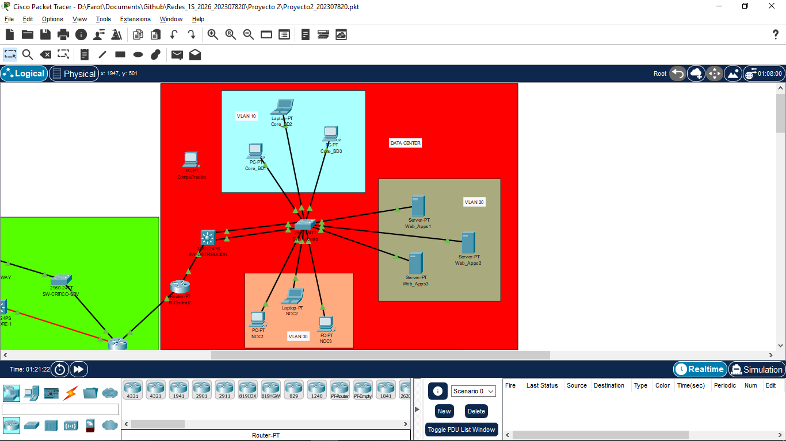

### Configuraciones del Data Center y Sede Central

#### Router 1

 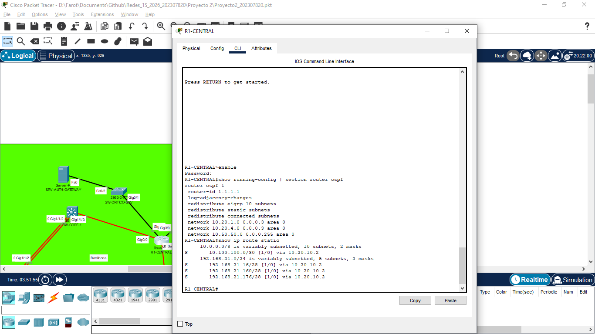

#### Router 2

 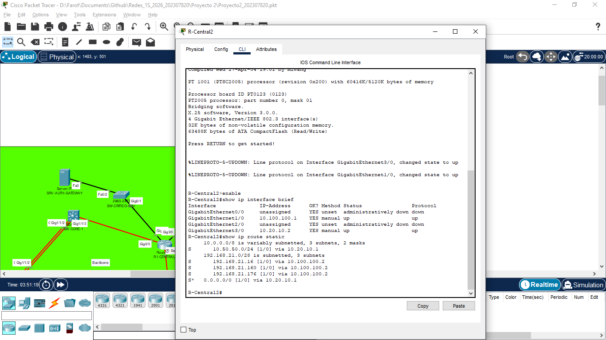

#### Switch Distribución

 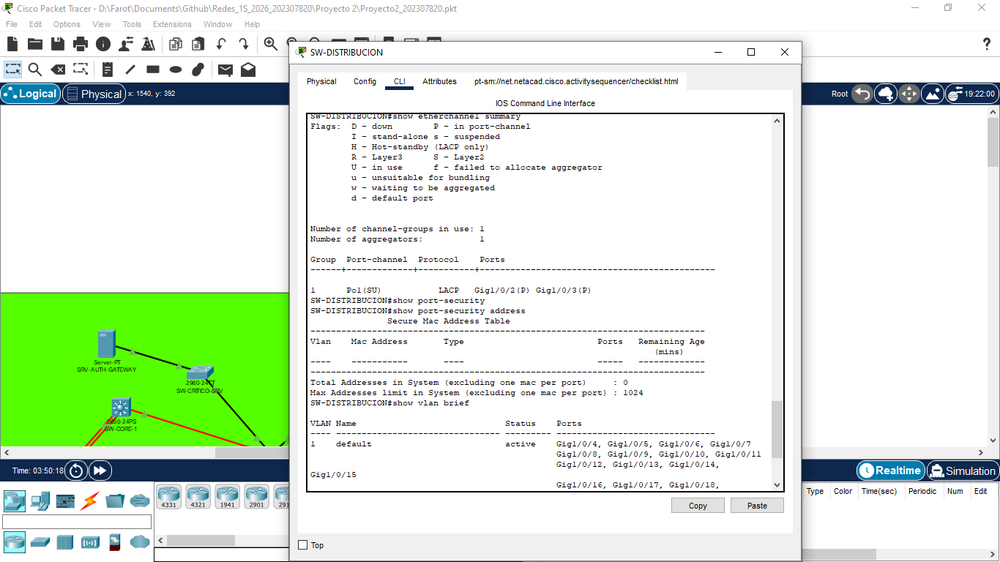

 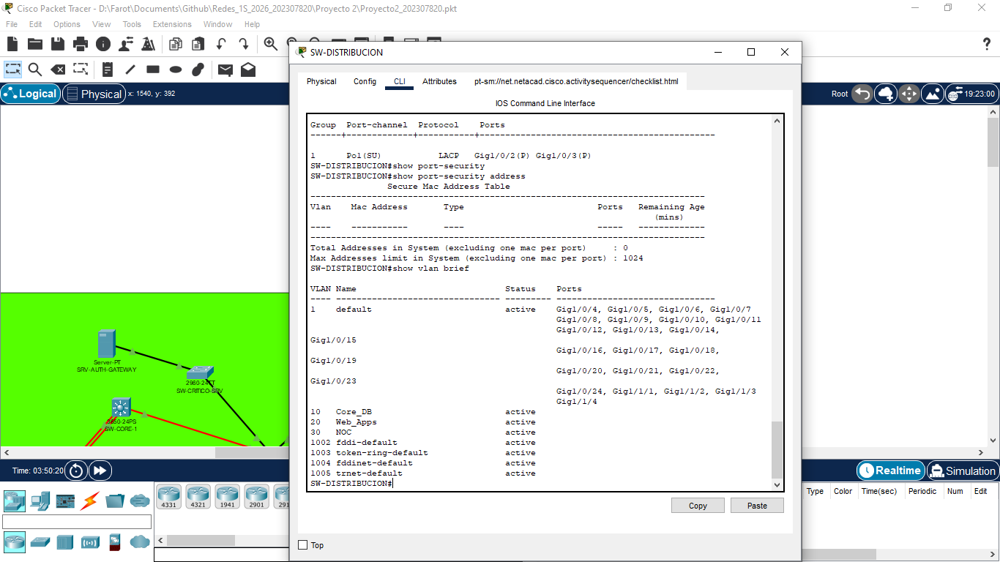

#### Switch de acceso

 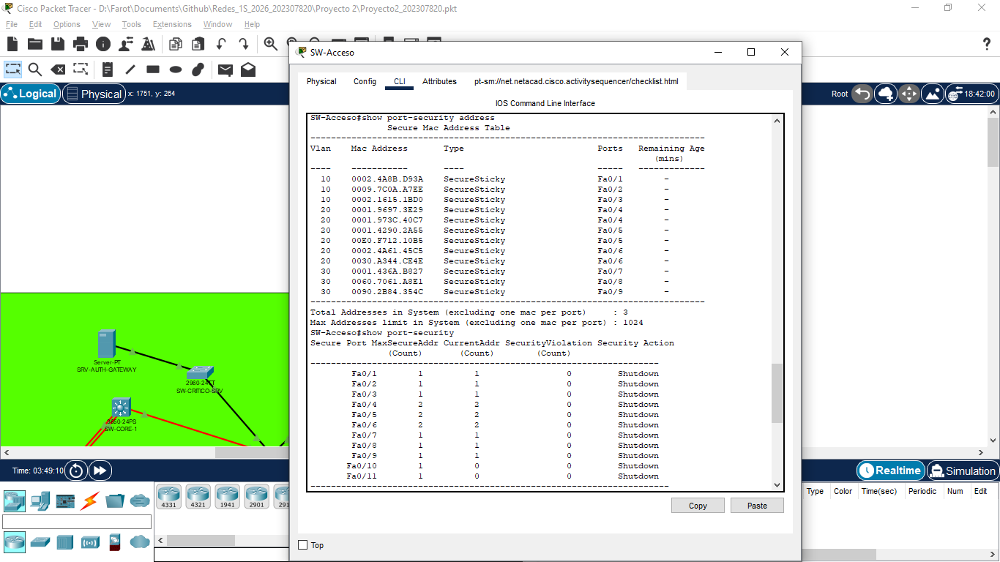

 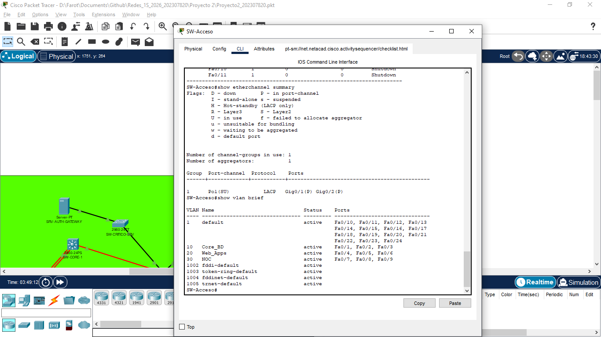

## Tabla de subnetting organizada por Sedes.

### 1. Sede Occidente (Agencia Regional Comercial)
| VLAN | Área Funcional | Hosts | ID de Red | Máscara (CIDR) | Rango IPs Útiles | Broadcast | Gateway |
|----------|------------|-------|-----------|----------------|------------------|---------| --------|
| 10 | Cajas | 45 | 192.168.20.0 | /26 (255.255.255.192) | .1 - .62 | .63 | .1 |
| 20 | Asesores | 30 | 192.168.20.64 | /27 (255.255.255.224) | .65 - .94 | .95 | .65 |
| 30 | Gerencia | 10 | 192.168.20.96 | /28 (255.255.255.240) | .97 - .110 | .111 | .97 |
| 40 | Seguridad | 12 | 192.168.20.112 | /28 (255.255.255.240) | .113 - .126 | .127 | .113 |

### 2. Sede Norte (Centro de Autorización de Créditos)
| VLAN | Área Funcional | Hosts | ID de Red | Máscara (CIDR) | Rango IPs Útiles | Broadcast | Gateway |
|----------|------------|-------|-----------|----------------|------------------|---------| --------|
| 50 | Análisis | 50 | 192.168.20.128 | /26 (255.255.255.192) | .129 - .190 | .63 | .1 |
| 60 | Auditoria | 25 | 192.168.20.192 | /27 (255.255.255.224) | .193 - .222 | .95 | .65 |
| 70 | Legal | 14 | 192.168.20.224 | /27 (255.255.255.224) | .225 - .238 | .225 | .239 |

### 3. Sede Oriente (Centro Financiero Legado)
| VLAN | Área Funcional | Hosts | ID de Red | Máscara (CIDR) | IP MS1 (Real) | IP MS2 (Real) |Rango IPs Útiles | Broadcast | Gateway |
|----------|------------|-------|-----------|----------------|---------------|---------------| -----------|---------| --------|
| 80 | Bóveda | 40 | 192.168.21.0 | /26 (255.255.255.192) | .2 | .3 | .4 - .62 | .63 | .1 |
| 90 | Plataforma | 60 | 192.168.21.64 | /26 (255.255.255.192) | .66 | .67 | .68 - .126 | .127 | .65 |

### 4. Data Center y Sede Central (Alta Seguridad)
| VLAN | Área Funcional | Hosts | ID de Red | Máscara (CIDR) | Rango IPs Útiles | Broadcast | Gateway |
|----------|------------|-------|-----------|----------------|------------------|---------| --------|
| 10 | Core_BD | 14 | 192.168.21.16 | /28 (255.255.255.240) | .18 - .30 | .31 | .17 |
| 20 | Web_Apps | 28 | 192.168.21.160 | /27 (255.255.255.240) | .161 - .174 | .175 | .161 |
| 30 | NOC | 10 | 192.168.21.176 | /28 (255.255.255.240) | .177 - .190 | .191 | .177 |

## Tabla de direccionamiento de VLANS

| ID VLAN | Nombre | Sede |
|---------|--------|----------------------- |
| 10 | Ventas_Cajas | Occidente |
| 20 | Asesores | Occidente |
| 30 | Gerencia_Local | Occidente |
| 40 | Seguridad_Occ | Occidente |
| 50 | Analistas_Cred | Norte |
| 60 | Auditoria_Norte | Norte |
| 70 | Legal_Norte | Norte |
| 80 | Boveda_Oriente | Oriente |
| 90 | Plataforma_VIP | Oriente |
| 10 | Core_BD | Central/DC |
| 20 | Web_Apps | Central/DC |
| 30 | NOC_Monitoreo | Central/DC |

## Pings exitosos Sede 1

### Vlan 10

 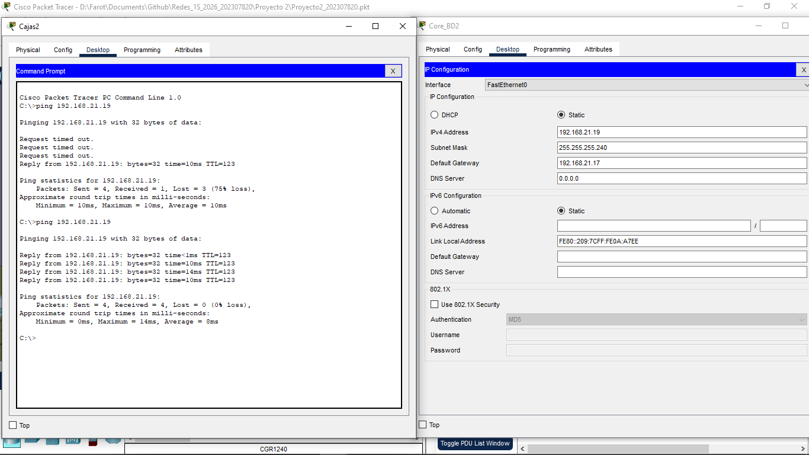

### Vlan 20

 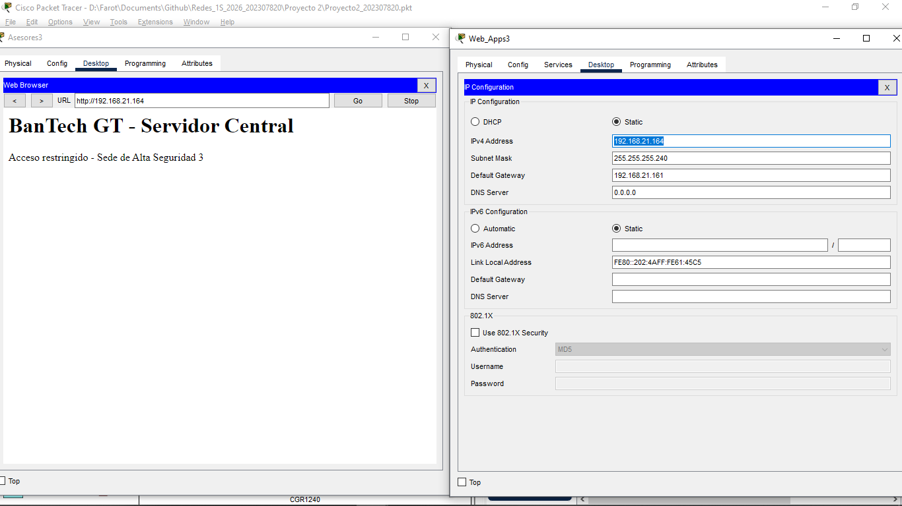

### Vlan 30

 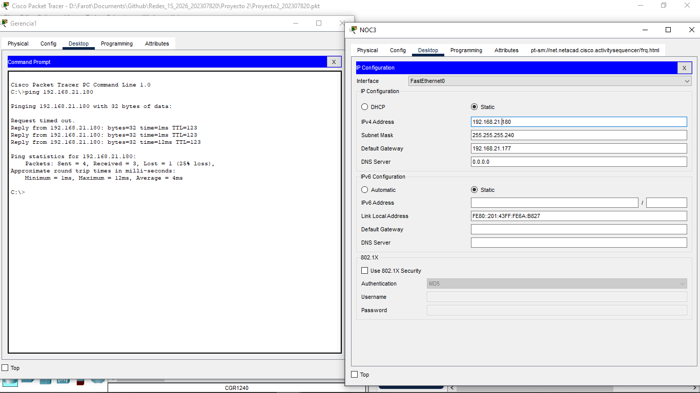

### Vlan 40

 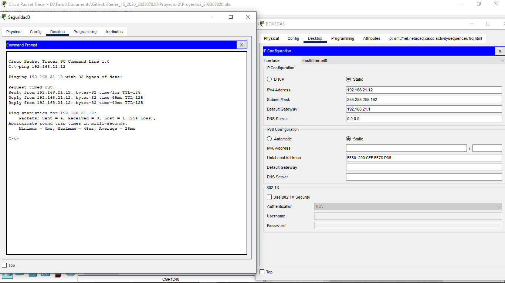

## Pings exitosos Sede 2

### Vlan 50

 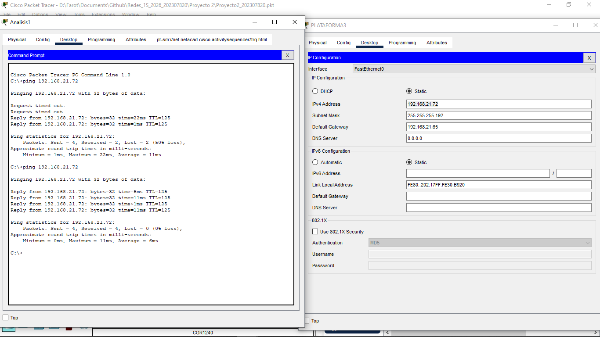

### Vlan 60

 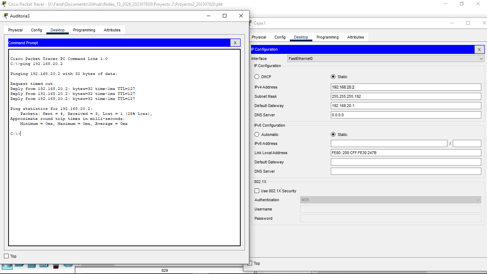

### Vlan 70

 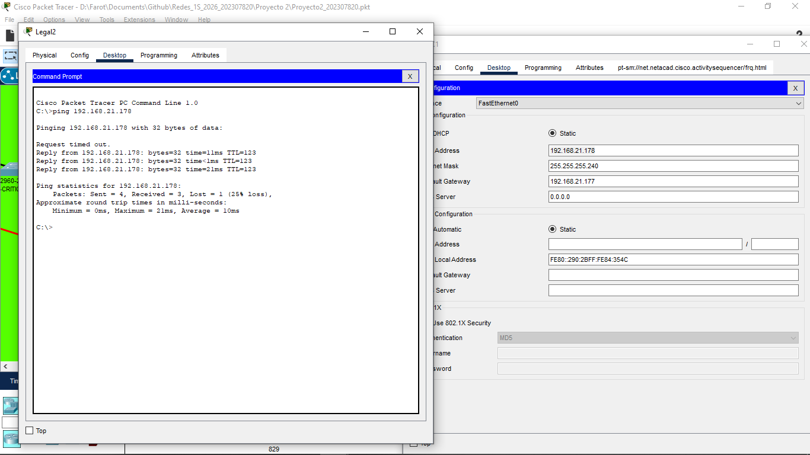

## Pings Exitosos Sede 3

### Vlan 80

 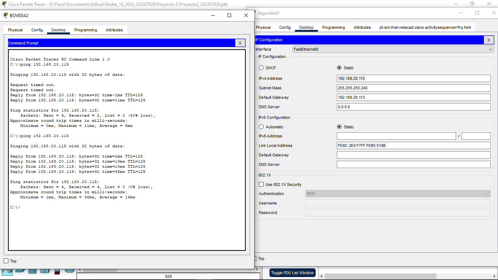

### Vlan 90

 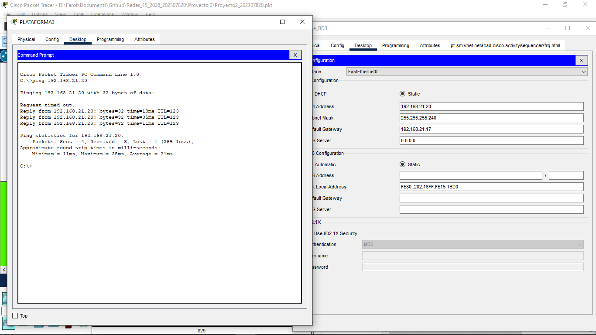

## Pings Exitosos Sede 4

### Vlan 10

 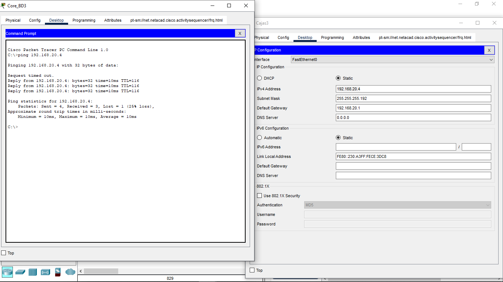

### Vlan 20

 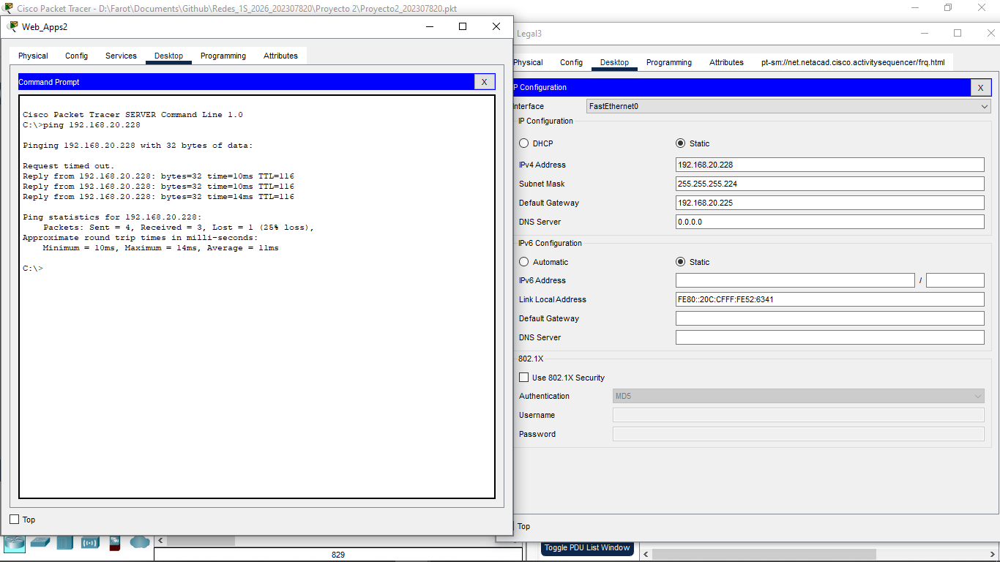

### Vlan 30

 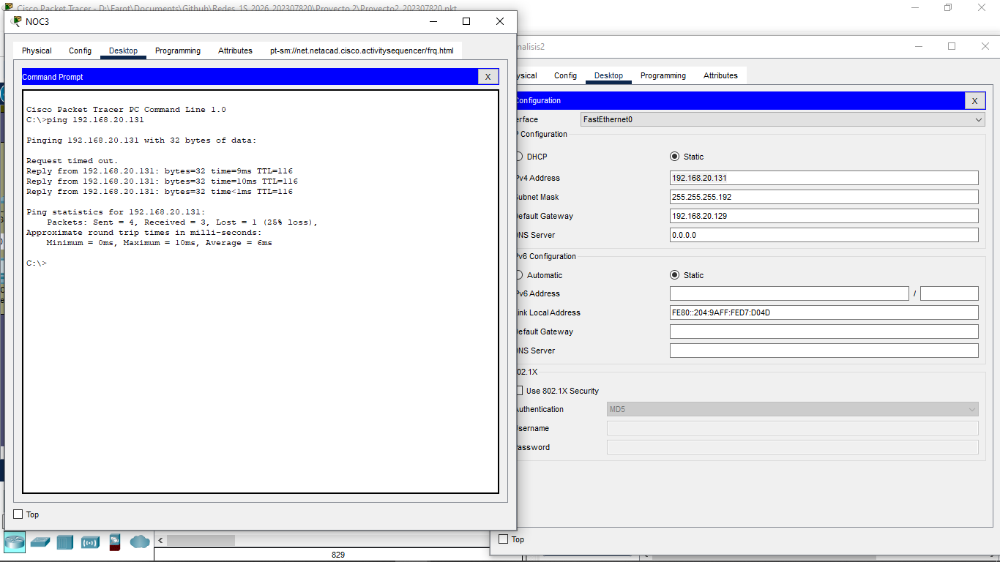

## Pruebas de HSRP

 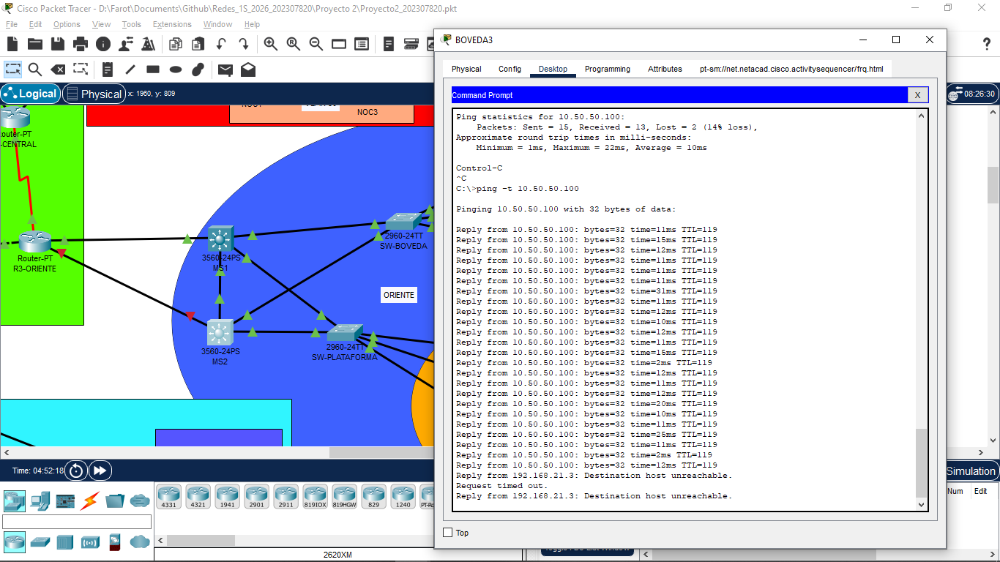

 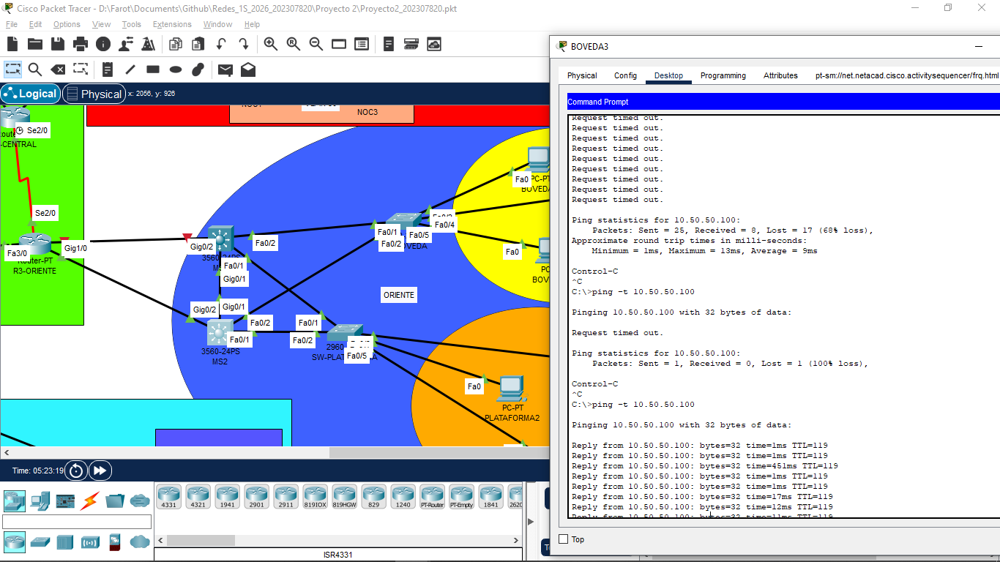

 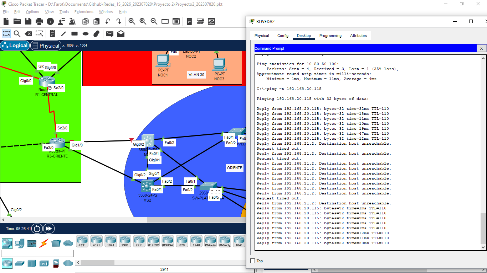

## Pruebas de STP

 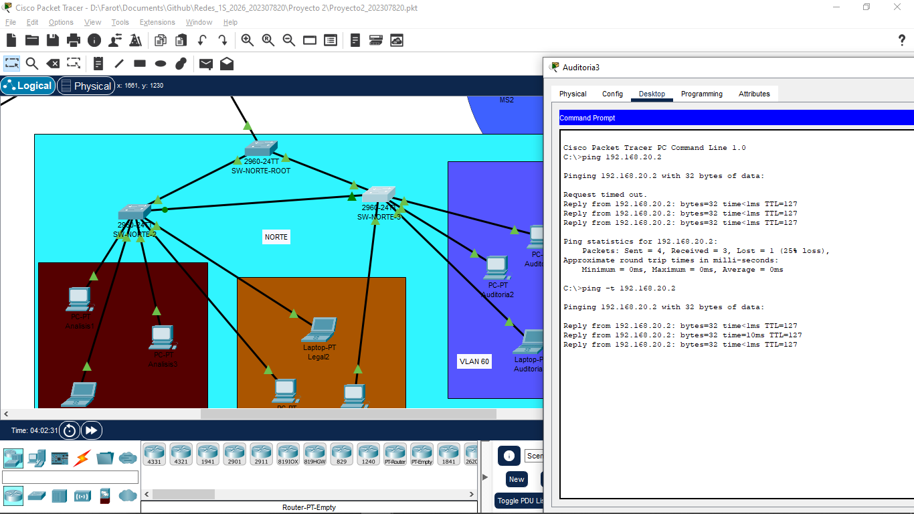

 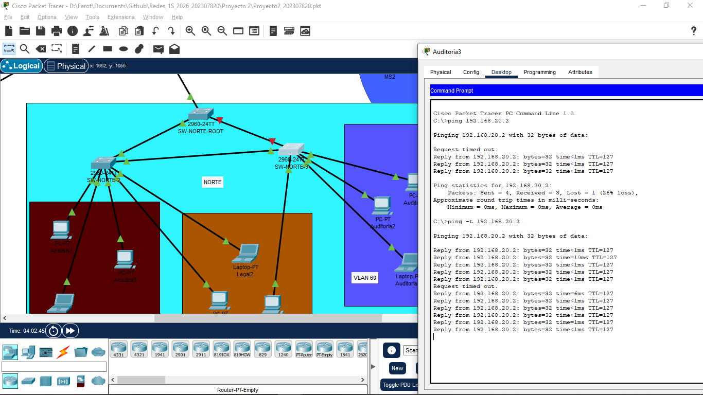

 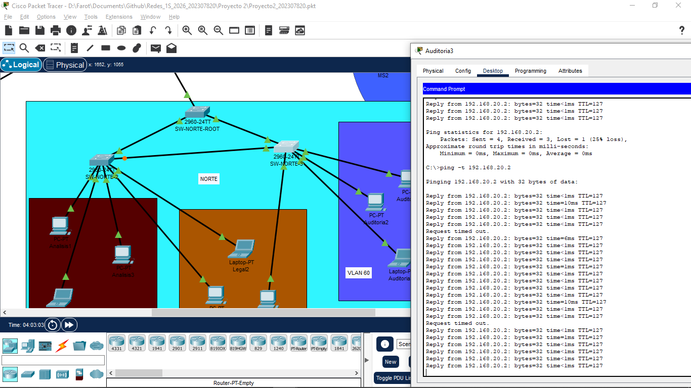

## Comando utilizados

### Configuración Básica y Capa 2 (Switches de acceso)

#### Creación de VLANs

vlan 10
* name Cajas

vlan 20
* name Asesores

vlan 30
* name Gerencia

exit

#### Configuración de Puertos de Acceso

interface range fa0/1 - 11
* switchport mode access
* switchport access vlan 10
* exit

#### Configuración de Enlaces Troncales

interface range Gi0/1
* switchport mode trunk
* switchport trunk allowed vlan 10,20,30
* exit

### Protocolos de Capa 2 (VTP, STP, EtherChannel, Port-Security)

#### VLAN Trunking Protocol (VTP)
* VTP mode Server
* vtp domain bantech20
* vtp password cisco
* vtp version 2

#### Spanning Tree (Rapid PVST+)

* spanning-tree mode rapid-pvst
* spanning-tree vlan 10,20,30 root primary
* spanning-tree vlan 10,20,30 root secondary

#### EtherChannel (LACP)
interface range gi 0/1 - 2
* channel-group 1 mode active
* exit
interface port-channel 1
* switchport mode trunk

#### Seguridad de Puertos (Port-Security)
interface fa 0/1
* switchport mode access
* switchport port-security
* switchport port-security maximum 1
* switchport port-security violation shutdown
* switchport port-security mac-address sticky

### Capa 3: Enrutamiento Inter-VLAN y Redundancia

#### Router-on-a-Stick (Subinterfaces en Routers)

interface gi0/0
* no shutdown
* exi

interface gi0/0.10
* encapsulation dot1Q 10
* ip address 192.168.10.1 255.255.255.0
* exi

#### SVI (Interfaces Virtuales en Switches Multicapa)
* ip routing
* interface vlan 10
* ip address 192.168.10.2 255.255.255.0
* no shutdown

#### HSRP (Redundancia de Gateway)

interface vlan 10
* standby 1 ip 192.168.10.1
* standby 1 priority 110
* standby 1 preempt

### Protocolos de Enrutamiento

#### OSPF
router ospf 1
* router-id 1.1.1.1
* network 10.10.10.0 0.0.0.3 area 0
* network 192.168.10.0 0.0.0.255 area 0

#### EIGRP
* router eigrp 10
* no auto-summary
* network 10.20.20.0 0.0.0.3

#### RIPv2
* router rip
* version 2
* no auto-summary
* network 172.16.0.0

#### Rutas Estáticas
* ip route 10.50.50.0 255.255.255.0 10.100.100.2

### Redistribución de Rutas

#### Redistribuir estáticas y EIGRP hacia OSPF

* router ospf 1
* redistribute static subnets
* redistribute eigrp 10 subnets

#### Redistribuir OSPF hacia EIGRP
* router eigrp 10
* redistribute ospf 1 metric 10000 100 255 1 1500

#### Redistribuir OSPF y estáticas hacia RIP
* router rip
* redistribute ospf 1 metric 2
* redistribute static metric 2

## Comandos para ver configuraciones

* show ip interface brief
* show running-config:
* show version
* show vlan brief
* show vtp status
* show spanning-tree
* show etherchannel summary
* show ip route
* show ip protocols
* show ip ospf neighbor
* show ip eigrp neighbors
* show ip route static
* show ip route rip
* show standby brief
* show port-security
* show port-security address