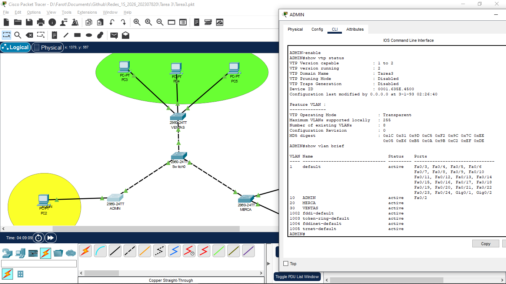
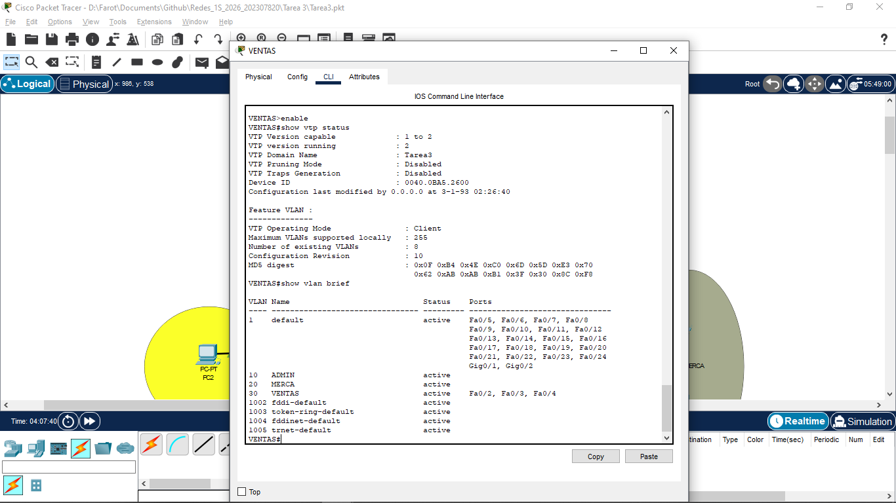
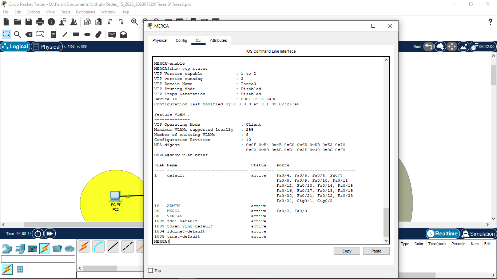
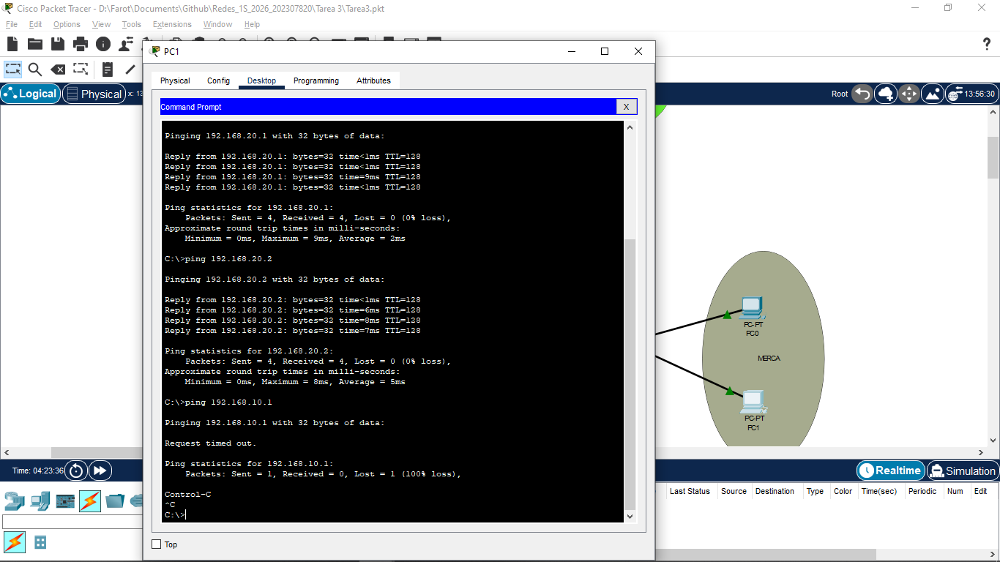
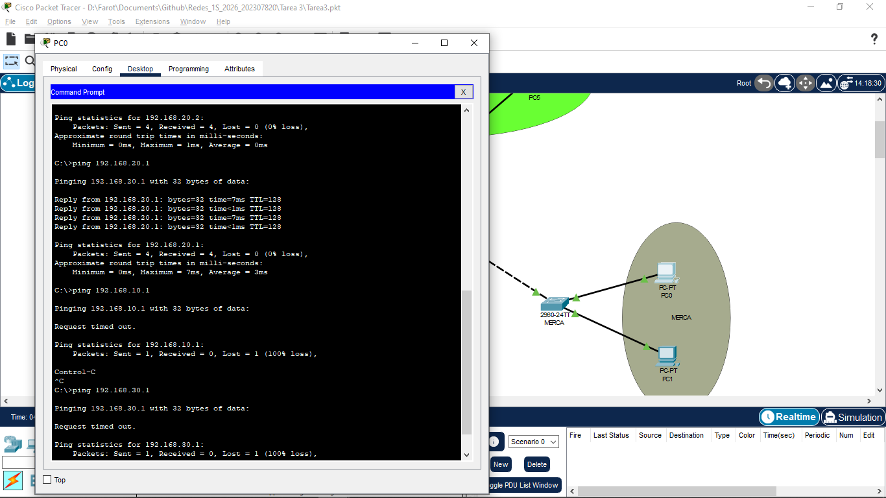
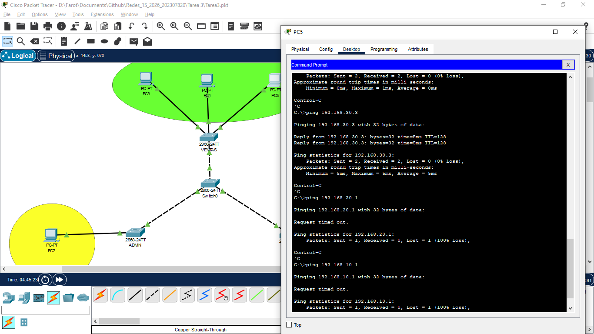
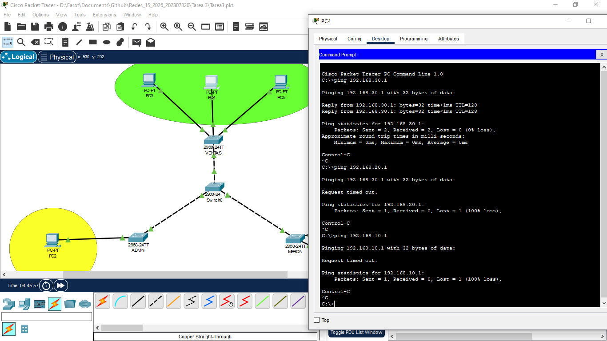
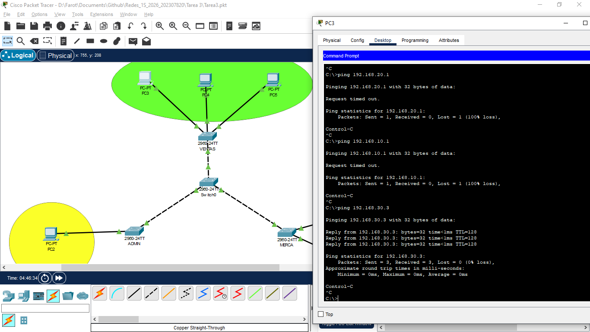

UNIVERSIDAD DE SAN CARLOS DE GUATEMALA

FACULTAD DE INGENIERIA

REDES DE COMPUTADORAS

CATEDRÁTICO: ING. ESPINO

============================================================================================

  
  

    <h1 style="color: White; text-decoration: underline; text-decoration-color: black;" >MANUAL TÉCNICO TAREA 3</h1>
  

============================================================================================

OTTONIEL FABRICIO VÁSQUEZ PINEDA
 
CARNÉ: 202307820
 
SECCIÓN A

GUATEMALA 28 DE Febrero DEL 2026

## **Configuración de switches**

### Para Switch 0
* enable
* config t
* vtp domain Tarea3
* vtp mode server
* vtp password cisco
* vtp version 2
* vlan 10
* name ADMIN
* exit
* vlan 20
* name MERCA
* exit
* vlan 30
* name VENTAS
* exit
* interface fa0/1
* switchport mode trunk
* switchport trunk allowed vlan 10,20,30
* no shutdown
* exit
* interface fa0/2
* switchport mode trunk
* switchport trunk allowed vlan 10,20,30
* no shutdown
* exit
* interface fa0/3
* switchport mode trunk
* switchport trunk allowed vlan 10,20,30
* no shutdown
* exit
* do wr
* exit

### Para Switch 1 (ADMIN)
* enable
* config t
* vtp domain Tarea3
* vtp mode trasnparent
* vtp password cisco
* vtp version 2
* vlan 10
* name ADMIN
* exit
* interface fa0/1
* switchport mode trunk
* switchport trunk allowed vlan 10,20,30
* no shutdown
* exit
* interface fa0/2
* switchport mode access
* switchport access vlan 10
* no shutdown
* exit
* do wr

### Para Switch 2 (VENTAS)
* enable
* config t
* vtp domain Tarea3
* vtp mode client
* vtp password cisco
* vtp version 2
* interface fa0/1
* switchport mode trunk
* switchport trunk allowed vlan 10,20,30
* no shutdown
* exit
* interface fa0/2-4
* switchport mode access
* switchport access vlan 30
* exit
* do wr

### Para switch 3 (MERCA)
* enable
* config t
* vtp domain Tarea3
* vtp mode client
* vtp password cisco
* vtp version 2
* interface fa0/1
* switchport mode trunk
* switchport trunk allowed vlan 10,20,30
* no shutdown
* exit
* interface fa0/2-3
* switchport mode access
* switchport access vlan 20
* exit
* do wr

---

## **Capturas de Comandos**

### SERVER

 

### ADMIN

 

### VENTAS

 

### MERCA

 

---

## **Capturas de PINGS**

### ADMIN

 

### MERCA

 

 

### VENTAS

 

 

 

